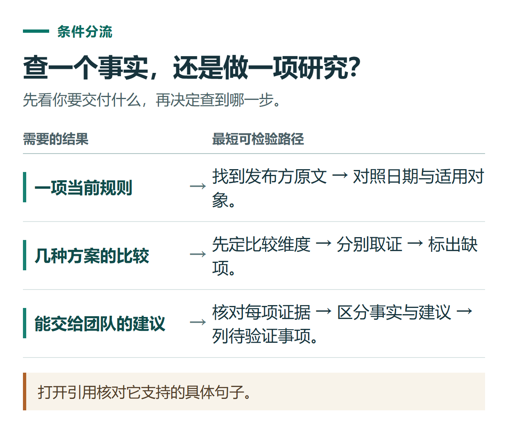
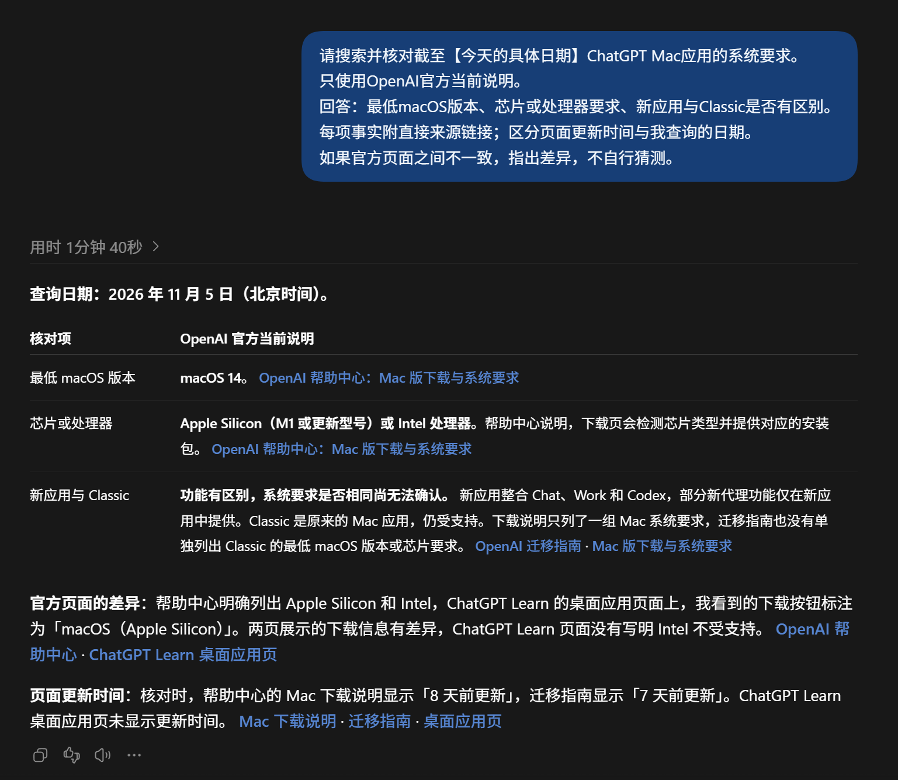

# ChatGPT 搜索与深度研究怎么用？从查一个事实到核对一份报告

[知识库首页](../README.md) · [搜索、PDF与研究](../ROADMAP.md#module-07) · [已上线教程](../README.md)

资料核对：2026-11-03。适用环境：ChatGPT网页；桌面端入口另作说明。练习提供提问方法，不预设实时搜索结果。

> **先看结论：** 查一个当前事实，可以使用搜索；需要比较多个来源、解释差异并形成报告，可以考虑深度研究。无论哪种方式，带有引用都不等于结论已经正确，重要信息仍要点开原文检查。

本篇帮助判断该用搜索还是研究；完整任务看深度研究流程，逐条判断引用是否支持结论看来源核查。

<details>
<summary>本篇导航</summary>

- [一、先选择任务规模](#section-01)
- [二、第一次搜索：把日期和来源说清楚](#section-02)
- [三、什么情况下值得用深度研究](#section-03)
- [四、怎样核对报告中的引用](#section-04)
- [五、报告完成后再要求改成可用成果](#section-05)

</details>

<a id="section-01"></a>

## 一、先选择任务规模

| 需要解决的问题 | 更合适的起点 | 应得到什么 |
|---|---|---|
| 某产品当前支持哪些系统 | 一次范围明确的搜索 | 事实、日期与官方链接 |
| 对比几种解决方案 | 搜索后整理，复杂时深度研究 | 比较标准、来源和差异 |
| 一份较长的专题调查 | 深度研究 | 研究范围、证据、报告与局限 |

官方[搜索与深度研究说明](https://learn.chatgpt.com/docs/web-search)介绍：网页版可在对话中请求当前信息；深度研究在Work的“+”菜单中选择，是否出现取决于账号和工作区。桌面应用则提供Deep research插件入口。



*打开引用核对它支持的具体句子。*

<a id="section-02"></a>

## 二、第一次搜索：把日期和来源说清楚

可以复制这个练习，日期替换为实际执行日期：

```text
请搜索并核对截至【今天的具体日期】ChatGPT Mac应用的系统要求。
只使用OpenAI官方当前说明。
回答：最低macOS版本、芯片或处理器要求、新应用与Classic是否有区别。
每项事实附直接来源链接；区分页面更新时间与我查询的日期。
如果官方页面之间不一致，指出差异，不自行猜测。
```

检查对话中是否出现实际搜索过程或引用。模型说“根据最新资料”，但没有可检查来源时，继续要求直接来源和对应依据；不要单靠这句话认定已经联网。



*一次实际搜索的回答示例。请打开原始来源复核，系统要求以当前官方页面为准。*

<a id="section-03"></a>

## 三、什么情况下值得用深度研究

如果问题需要多个判断维度，不妨先写研究任务书。例如，你准备选择一种整理长期知识资料的方法：

```text
请研究个人知识库使用ChatGPT项目管理资料的适用方式。
目标读者：每周整理10份以内资料的中文内容作者。
范围：项目组织、文件、指令、记忆设置、结果核查。
优先采用OpenAI官方当前文档。
输出：适用任务、建议操作流程、限制、仍需本人测试的事项。
每个产品事实标出来源；编辑建议与官方事实分开。
先列研究计划，再开始收集资料。不要添加未经核实的效率数据。
```

在网页的Work中打开“+”菜单，选择可用的Deep research，再提交任务。如果没有入口，先使用普通搜索把问题拆成几项，不因为这次任务立刻购买不明确的产品。

计划阶段应检查范围是否跑偏。例如，你只想了解个人资料整理，报告不需要扩展成全部企业AI平台的行业综述。发现偏离就及时缩小问题。

<a id="section-04"></a>

## 四、怎样核对报告中的引用

挑选最影响判断的结论逐条检查：

1. **链接能否打开。** 引用标题看起来正确，不代表目标页面真的存在。
2. **原文是否支持这句话。** “某套餐支持某功能”不能由一个泛泛的产品介绍页证明。
3. **条件是否一致。** 平台、地区、套餐、工作区和版本不能混用。
4. **时间是否合适。** 旧发布公告可以说明当时发生了什么，不一定能证明今天仍然如此。
5. **推断有没有标出。** 根据资料提出的建议，应与官方直接陈述分开。

可以建立一个小表：结论、来源、原文位置、适用条件、是否确认。检查重要结论即可，不必机械核对每句连接语。

<a id="section-05"></a>

## 五、报告完成后再要求改成可用成果

来源确认后，可以继续说：“把已确认内容整理成一页选用建议，保留影响决定的限制，未证实内容移入待核对列表。”这样比一开始要求漂亮长文更容易检查。

搜索还适合给文章补事实，但不能让资料检索替你虚构体验。后续可结合公众号与短视频改编案例，把已核实的事实写成面向读者的内容。

## 接下来按你的情况继续

- 完整深度研究流程：完成选题、研究计划、来源限定、报告与核对。
- 逐条核查来源：把结论对应到可打开的原始页面，识别推断与未知。

[返回搜索、PDF与研究专题](../ROADMAP.md#module-07) · [完整目录](../ROADMAP.md)
