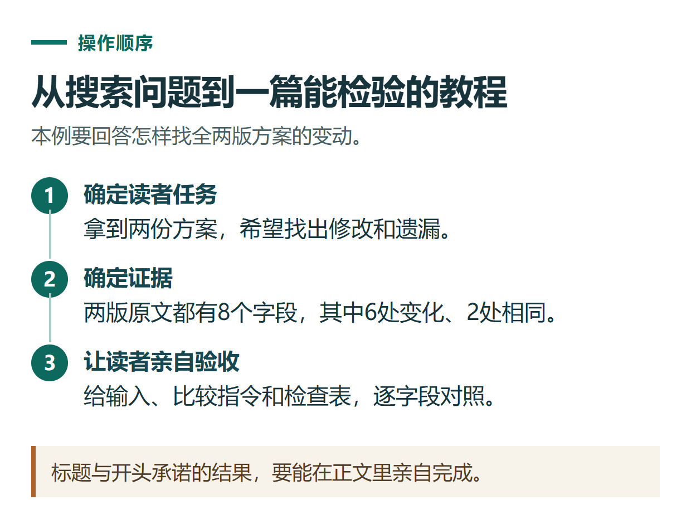

# 用 ChatGPT 规划 SEO 文章：从读者问题到提纲、依据和内部链接

[知识库首页](../README.md) · [办公与内容创作](../catalog/topics/work.md) · [按问题找答案](../catalog/TASKS.md)

资料核对：2026-11-03。适用环境：内容策划与写作；关键词为编辑候选，没有搜索量或排名数据。

> **先看结论：** SEO文章先解决一个明确问题，再组织标题、正文和链接。让ChatGPT列一长串关键词，不能替代资料核对、实际步骤和原创案例。

Google的内容指南强调实用、可靠和面向读者的价值，并不规定文章必须达到某个字数。[Google实用内容指南](https://developers.google.com/search/docs/fundamentals/creating-helpful-content?hl=zh-cn)

<details>
<summary>本篇导航</summary>

- [一、先写一张文章需求单](#section-01)
- [二、把关键词改成真实问题](#section-02)
- [三、标题准确，开头直接回答](#section-03)
- [四、用证据表约束初稿](#section-04)
- [五、发布前检查链接与读者下一步](#section-05)

</details>

<a id="section-01"></a>

## 一、先写一张文章需求单

以下使用原创案例“ChatGPT对比两份文档”：

```text
目标读者：手里有两份版本，不知道哪里变了的人。
核心问题：如何比较差异，并避免漏项。
已有材料：两份虚构活动方案、8个字段、6处变化和2处不变。
完成目标：读者能按同样方法检查自己的文件。
不覆盖：会员购买、软件安装、合同法律效力判断。
```

范围清楚后，文章才不容易从文档比较突然扩成所有AI功能的百科介绍。



*标题与开头承诺的结果，要能在正文里亲自完成。*

<a id="section-02"></a>

## 二、把关键词改成真实问题

```text
请根据需求单列出一个主搜索意图和5个相关读者问题。
不提供虚构搜索量、难度或排名预测。
为每个问题标明正文应给什么答案或示例。
已有其他教程解释过的基础内容用内链承接。
```

可用问题包括：怎样区分新旧版本、先提取哪些字段、怎么检查漏项、扫描文件看不清怎么办、最终如何保存差异表。这些问题能直接决定章节内容。

<a id="section-03"></a>

## 三、标题准确，开头直接回答

标题可以是“ChatGPT对比两份文档：找出改动并检查遗漏”。开头说明先确定版本、提取字段、比较并反向核对，然后进入步骤。

不需要把“教程、攻略、方法、技巧、大全”全部堆进标题。使用年份时，应确实对应核对过的版本；未来年份或仅刷新日期，不能代替内容更新。Google指南也提醒不要只改日期制造新鲜感。[内容日期与质量检查](https://developers.google.com/search/docs/fundamentals/creating-helpful-content?hl=zh-cn)

<a id="section-04"></a>

## 四、用证据表约束初稿

```text
请按提纲写初稿，并单独列事实核对表。
产品能力附官方来源，原创练习明确标注。
没有实际运行的结果不要写“亲测”。
在需要截图的步骤留可见占位，写出要展示的操作和结果。
```

文中给完整材料和检查答案，读者才有条件实践。来源只支持具体事实，不能把官方链接放在文末就当作全部观点的证明。

<a id="section-05"></a>

## 五、发布前检查链接与读者下一步

内部链接应帮助读者完成当前任务，例如链接到PDF识别和下载排查；服务入口放在确实涉及办理需求的地方，说明独立第三方身份与实际条件。

发布后用真实问题、访问和咨询反馈判断是否需要改写，不用文章数量推断排名。内容发布计划可结合[多平台排期](chatgpt-content-calendar.md)，来源检查可用[证据核对流程](chatgpt-research-source-checking.md)。

## 接下来按你的情况继续

- [逐条核查来源](chatgpt-research-source-checking.md)：把结论对应到可打开的原始页面，识别推断与未知。
- [GitHub README](chatgpt-github-readme-docs.md)：生成面向读者的简介、目录和有效相对链接。

[返回办公与内容创作专题](../catalog/topics/work.md) · [完整文章索引](../catalog/ALL_ARTICLES.md)
