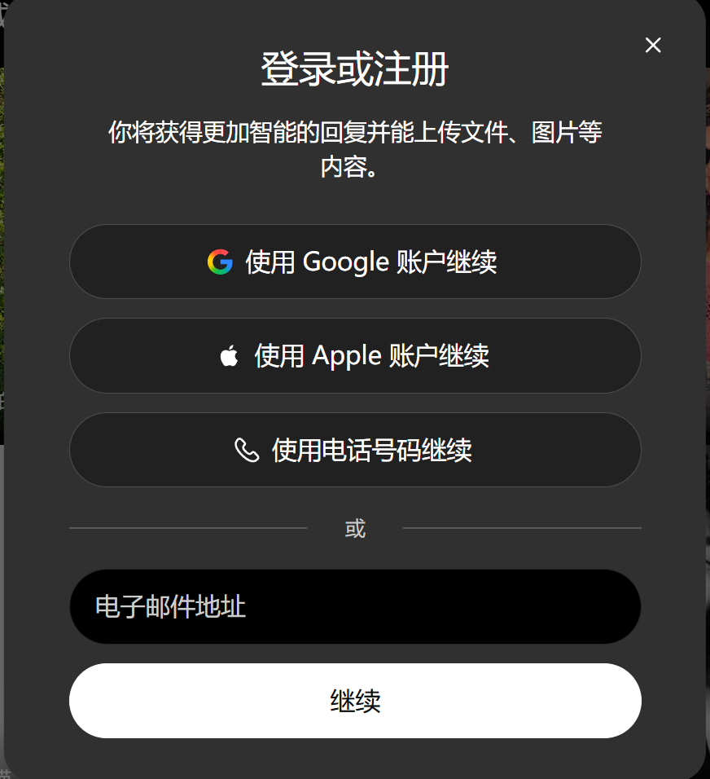
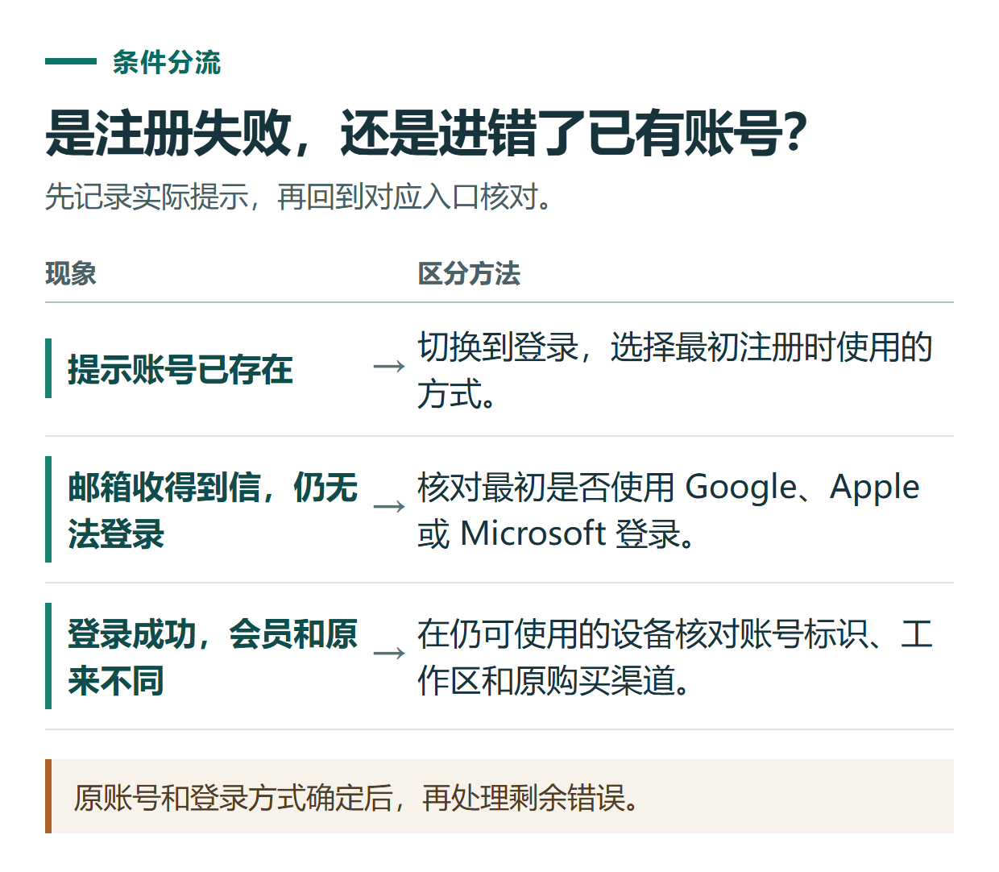
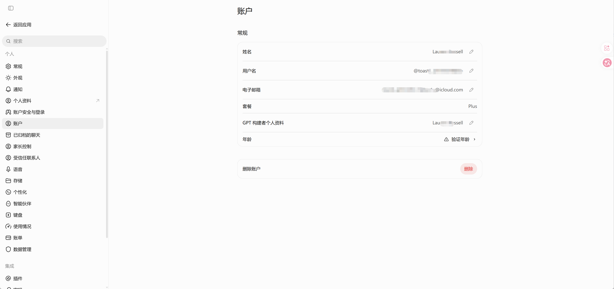

# ChatGPT 注册与登录教程：邮箱、Google、Apple 账号怎么选

[知识库首页](../README.md) · [登录、隐私与账号](../ROADMAP.md#module-02) · [已上线教程](../README.md)

资料核对：2026-11-03。适用环境：ChatGPT 官方网页；使用前先确认[地区与账号准备事项](chatgpt-china-preparation.md)。

> **先看结论：** 注册 ChatGPT 时，最重要的不是选择看起来最快的按钮，而是选择你能长期访问的邮箱或第三方账号。以后换电脑、续费、找回订阅，都需要准确登录原来的账号。

<details>
<summary>本篇导航</summary>

- [一、第一次注册怎么操作](#section-01)
- [二、已有账号，优先使用原来的入口](#section-02)
- [三、收不到验证码，按这个顺序排查](#section-03)
- [四、常见报错怎样处理](#section-04)
- [五、给自己留一份登录记录](#section-05)

</details>

<a id="section-01"></a>

## 一、第一次注册怎么操作

1. 在浏览器中打开 [chatgpt.com](https://chatgpt.com/)，从官方页面进入注册。
2. 选择页面实际提供的方式，例如邮箱、Google、Microsoft 或 Apple。不要把注册与登录两个入口混用。
3. 按页面提示完成身份验证。只有在官方流程要求时，才在对应页面填写必要资料；不要照着旧教程预先购买所谓“必需”的验证材料。
4. 进入主界面后，打开个人资料或设置，确认账号邮箱。若使用 Apple 隐藏邮箱，显示的可能是 Apple 中继邮箱，应记录实际账号标识。
5. 发起一次简单对话，再退出并用同一种方式重新登录，确认自己知道如何回来。

OpenAI 的[登录帮助](https://help.openai.com/en/articles/7426629-why-cant-i-log-in-to-chatgpt)建议遇到登录问题时先核对原始注册方式；[登录方式说明](https://help.openai.com/en/articles/4936824-changing-your-account-sign-in-method)解释了邮箱、第三方登录及 Apple 隐藏邮箱的关系。



*登录入口示例，实际选项以页面显示为准。*

<a id="section-02"></a>

## 二、已有账号，优先使用原来的入口

例如，最初点击“使用 Google 继续”注册，换设备后先点击同一选项。不要因为记得自己的 Gmail 地址，就认定以前一定设置过独立的 ChatGPT 密码。

当前官方资料也提供了符合条件的账号在“设置 → 安全与登录 → 密码”中添加密码的路径。因此，“第三方登录永远无法添加密码”不是适用于所有账号的结论。如果账号里没有对应设置，按当前页面和官方支持处理，不要反复尝试不存在的密码。

<a id="section-03"></a>

## 三、收不到验证码，按这个顺序排查

1. 先看屏幕要求的是邮箱验证码，还是已经登录设备上的确认通知。
2. 核对收件地址，检查垃圾邮件、推广分类和邮箱容量。
3. 有多封验证码时使用最近一次请求对应的邮件；不要连续点击发送，把新旧验证码混在一起。
4. 如果页面提供“尝试通过邮件验证”等替代选项，可以按提示切换。
5. 仍不成功时，记下发生时间、登录方式及错误原文，通过官方帮助中心反馈。

新设备或需要额外确认的登录可能触发邮箱验证码或应用确认通知，具体以当前验证页面为准。[官方登录验证说明](https://help.openai.com/en/articles/9889414-why-am-i-being-asked-to-verify-my-login)

<a id="section-04"></a>

## 四、常见报错怎样处理

| 现象 | 先做什么 | 不要急着做什么 |
|---|---|---|
| 提示账号已存在 | 回到登录，用原注册方式尝试 | 反复创建同一个账号 |
| 邮箱能收到邮件，但登录方式错误 | 核对是否原来使用 Google、Apple 或 Microsoft | 认定邮箱坏了 |
| 页面循环跳转、空白或验证失败 | 换干净的浏览器窗口，检查扩展与 Cookie 设置 | 直接购买新账号 |
| 登录后看不到原来的会员 | 核对账号邮箱、工作区和原付款渠道 | 在当前账号重复购买 |
| 多个设备同时异常 | 查看 [OpenAI 服务状态](https://status.openai.com/) | 把所有问题都解释为被封号 |

浏览器排查前先保存未发送的文字。清除站点数据会让你退出登录，应该确认自己知道原登录方式后再操作。



*原账号和登录方式确定后，再处理剩余错误。*



*账号设置示例，可在此核对邮箱和套餐。*

<a id="section-05"></a>

## 五、给自己留一份登录记录

```text
注册日期：
注册方式：邮箱 / Google / Microsoft / Apple
账号标识：仅保存在自己的安全笔记中
是否使用 Apple 隐藏邮箱：
主要设备：
已有订阅的付款渠道：没有 / 网页 / Apple / Google Play / 第三方订单
```

不要把密码和验证码写进公开笔记或截图。确认账号能正常使用后，继续阅读[网页版第一次对话](chatgpt-web-basics.md)。如果问题是“已付款但会员不见了”，转到[订阅未生效排查](chatgpt-payment-troubleshooting.md)，先找回正确账号和订单。

## 接下来按你的情况继续

- [网页版第一次使用](chatgpt-web-basics.md)：得到事实完整的工作群通知并学会自行检查。
- 密码恢复与更换邮箱：按原认证方式恢复登录并检查自助换邮箱资格。

[返回登录、隐私与账号专题](../ROADMAP.md#module-02) · [完整目录](../ROADMAP.md)
