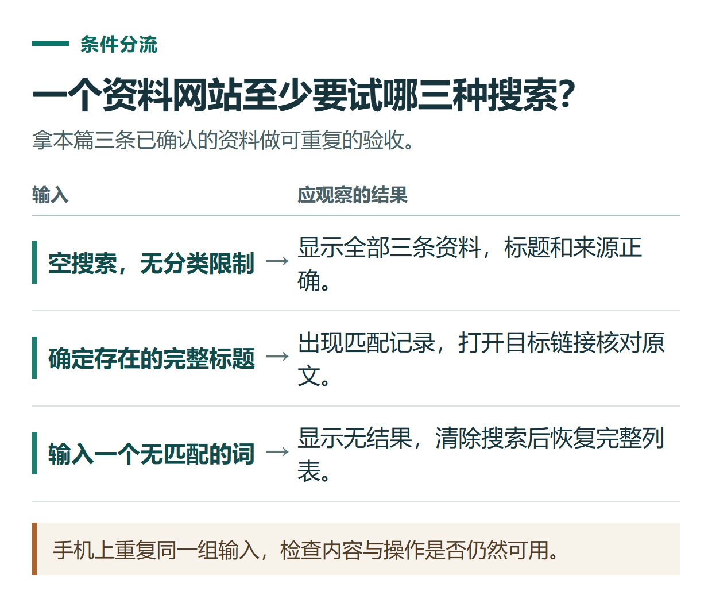

# ChatGPT Sites 建站实践：做一个资料导航页，先保存检查再决定发布

[知识库首页](../README.md) · [工具连接与协作](../catalog/topics/tools.md) · [按问题找答案](../catalog/TASKS.md)

资料核对：2026-11-03。适用环境：账号已开放Sites功能的网页或桌面端；本篇提供原创练习规格，不代表已建站。

> **先看结论：** 第一次用Sites，可以做一个不收集个人资料的导航页。先把访问者、内容和点击行为讲清楚，再检查页面是否能用。保存设计版本与保存访问者填写的数据，是两件不同的事。

<details>
<summary>本篇导航</summary>

- [一、先准备三条真实可核对的资料](#section-01)
- [二、写清第一版行为](#section-02)
- [三、按访问者视角测试](#section-03)
- [四、定点修改，不随意扩大功能](#section-04)
- [五、准备发布时再确认访问范围](#section-05)

</details>

<a id="section-01"></a>

## 一、先准备三条真实可核对的资料

本例导航收录官方的[使用说明](https://learn.chatgpt.com/docs/use-chatgpt)、[提示指南](https://learn.chatgpt.com/docs/prompting)和[图像生成指南](https://learn.chatgpt.com/docs/image-generation)。

每条记录包含标题、用途、分类和原始链接。先自己打开核对，不让模型为凑卡片补出不存在的页面。

<a id="section-02"></a>

## 二、写清第一版行为

```text
请用Sites制作一个中文AI学习资料导航网站。
只使用我给出的三条官方资料，展示标题、用途、分类和来源链接。
提供标题搜索与分类筛选；空搜索显示全部，无结果时提示清除筛选。
适合手机阅读，不需要登录、表单、付费或保存访客记录。
先保存可审阅版本，不部署，我要检查内容和链接。
```

官方说明可通过包含website的请求或 `@Sites` 进入流程，实际入口受账号与工作区设置影响；所有部署链接均属于正式部署，想先检查时应明确要求保存而不部署。[Sites创建说明](https://learn.chatgpt.com/docs/sites/creating-a-site)

<a id="section-03"></a>

## 三、按访问者视角测试

清空搜索时应有三条；搜索“图像”应找到图像指南；输入不存在的词应显示无结果提示。点击每条来源，确认打开正确官方页面。

缩窄窗口，检查卡片、按钮和长链接是否挤出屏幕。若搜索只匹配标题，就不要在界面上声称能搜索全文。



*手机上重复同一组输入，检查内容与操作是否仍然可用。*

<a id="section-04"></a>

## 四、定点修改，不随意扩大功能

```text
请把搜索框移到分类筛选上方，并增强无结果提示。
保留三条资料及原链接，不新增登录和表单。
继续保存审阅版本，修改后重试三组搜索。
```

如果后来要加入收藏、评论或报名，就需要进一步确认数据存储、身份和访问权限。官方说明网站版本保存不会自动解决访客记录持久化问题。[记录与存储说明](https://learn.chatgpt.com/docs/sites/creating-a-site)

<a id="section-05"></a>

## 五、准备发布时再确认访问范围

确认内容、链接、访问对象和当前方案的托管条件，再选择发布。发布后使用预期访问者身份打开链接检查；作者能访问不等于其他人能访问。

个人或团队权限、流量和存储要求，需要按当前官方页面与账号实际条件确认，本篇不把测试阶段信息写成永久免费承诺。想先练习本地单文件，可看[离线HTML工具](chatgpt-html-mini-tool.md)；需求较复杂时先写[需求文档](chatgpt-product-requirements.md)。

需要协助配置自己的工具、工作流或知识库时，可了解[小小AI安装与定制服务](https://xiaoxiao-ai.com/?utm_source=github&utm_medium=referral&utm_campaign=chatgpt_guide&utm_content=a73_implementation)。这是维护者提供的独立第三方服务；先说明设备、输入、目标与验收要求，再确认范围和费用。

## 接下来按你的情况继续

- [需求文档](chatgpt-product-requirements.md)：整理轻量文章跟踪工具的范围与验收条件。
- [HTML人数小工具](chatgpt-html-mini-tool.md)：生成本地人数计算器并按样例检查交互。

[返回工具连接与协作专题](../catalog/topics/tools.md) · [完整文章索引](../catalog/ALL_ARTICLES.md)
