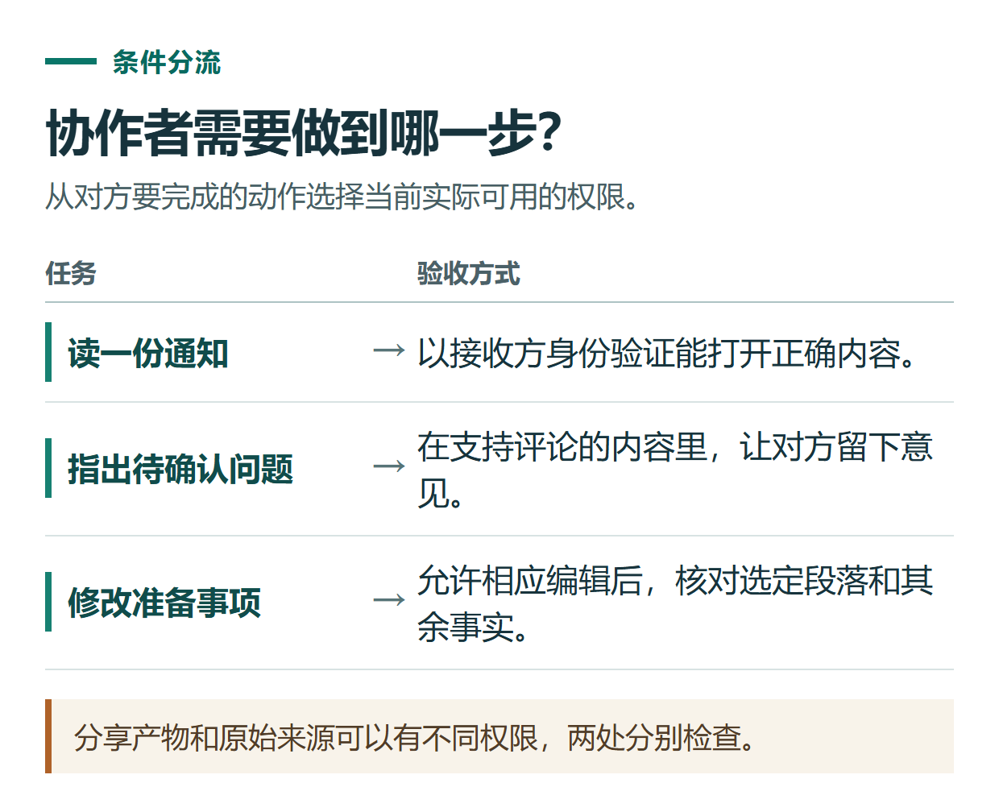

# ChatGPT Space 协作审稿：设置权限、留下评论与确认最终版本

[知识库首页](../README.md) · [工具连接与协作](../catalog/topics/tools.md) · [按问题找答案](../catalog/TASKS.md)

资料核对：2026-11-03。适用环境：已开放Space与相应共享能力的账号；练习页面不含真实业务资料。

> **先看结论：** 多人一起改稿前，先明确谁负责修改、谁只给意见、谁最终确认。共享页面可以减少来回传文件，但权限和最终版本仍需要实际检查。

<details>
<summary>本篇导航</summary>

- [一、先用一页虚构通知练习](#section-01)
- [二、给对方刚好需要的访问权限](#section-02)
- [三、评论写问题，正文放确认后的内容](#section-03)
- [四、验证接收方看到的真实效果](#section-04)
- [五、结束协作后检查继承权限](#section-05)

</details>

<a id="section-01"></a>

## 一、先用一页虚构通知练习

页面正文写：活动面向8位新同事，时长40分钟，日期与地点待确认。约定作者改正文，审阅者指出问题，负责人确认最终内容。角色名称是本例分工，不是新增产品权限档位。

先按[Pages编辑教程](chatgpt-pages-editing.md)创建页面，检查正文中没有私人聊天摘录或不应共享的文件内容。

<a id="section-02"></a>

## 二、给对方刚好需要的访问权限

打开共享设置，选择实际提供的接收对象与权限。官方Space说明列有查看、评论和编辑，但不同对象与内容类型不一定提供所有选项，例如Slides的权限范围另有说明。[Space协作说明](https://learn.chatgpt.com/docs/space/collaboration)

审阅者只需提意见时，优先使用当前可用的评论权限；没有该选项则重新约定反馈方式。不要为了方便把所有人都设为编辑。



*分享产物和原始来源可以有不同权限，两处分别检查。*

<a id="section-03"></a>

## 三、评论写问题，正文放确认后的内容

一条有用的评论可以是：“此处日期尚未确认，请保留待确认，不自行填写。”比“这里再优化”更容易执行。

需要ChatGPT修改时，可以使用：

```text
请只改“参加前准备”一节，让新同事知道需要带什么材料。
依据现有练习要求写，不新增收费和报名条件。
保留8人、40分钟及日期地点待确认。
完成后列出本次改动，其他章节保持原样。
```

审阅后再处理评论。评论被标记完成，不自动等于对应事实已得到负责人确认。

<a id="section-04"></a>

## 四、验证接收方看到的真实效果

让有权参与的协作者用自己的账号打开页面，确认是否能查看、评论或编辑。自己作为作者能打开，只证明作者权限有效。

页面能读，不代表链接到的源文件也能读；反过来，复制进共享页面的文字已经属于页面可见内容，需要另外检查。官方提醒源材料权限与页面权限分别判断。[协作与来源访问](https://learn.chatgpt.com/docs/space/collaboration)

<a id="section-05"></a>

## 五、结束协作后检查继承权限

页面可能继承父页面或Space的访问权限，移除一条直接邀请，不一定切断全部访问。需要调整时查看权限来源，再到对应层级修改。[继承权限说明](https://learn.chatgpt.com/docs/space/collaboration)

最终版记录日期和确认人，在团队约定的位置保留。若要交付离线文档，再核对导出文件与页面的一致性。项目共享与页面共享也不是同一个对象，长期资料组织可以结合[多文件项目实践](chatgpt-projects-multi-file-case.md)。

## 接下来按你的情况继续

- [Pages文稿编辑](chatgpt-pages-editing.md)：创建可编辑页面，完成选段修改、评论和共享范围检查。
- [多文件项目案例](chatgpt-projects-multi-file-case.md)：用需求、资源和旧记录生成有版本依据的活动方案。

[返回工具连接与协作专题](../catalog/topics/tools.md) · [完整文章索引](../catalog/ALL_ARTICLES.md)
