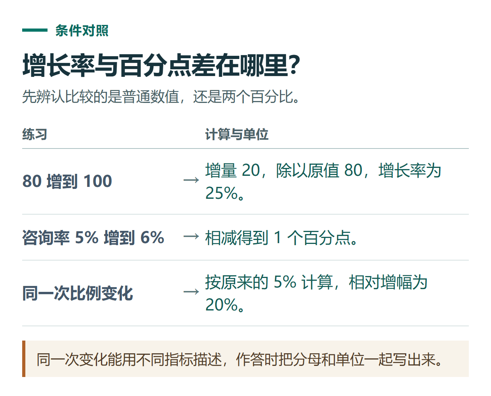

# ChatGPT 学习模式怎么用？用增长率练习做到会解释、会独立计算

[知识库首页](../README.md) · [学习、求职与表达](../catalog/topics/learning.md) · [按问题找答案](../catalog/TASKS.md)

资料核对：2026-11-03。适用环境：普通ChatGPT对话的Study模式；题目为原创练习。

> **先看结论：** 学习模式适合希望弄懂过程、练习和查漏的人。不要只让它直接给答案，可以要求每次问一个问题、先提示再解释，最后用新题检查自己是否真正理解。

<details>
<summary>本篇导航</summary>

- [一、先在普通对话中打开Study](#section-01)
- [二、先说出自己的基础和困惑](#section-02)
- [三、用三道题检查理解](#section-03)
- [四、要求它给新题，并记录错因](#section-04)
- [五、把练习收束成可复习的记录](#section-05)
- [六、上传课件时怎样问](#section-06)

</details>

<a id="section-01"></a>

## 一、先在普通对话中打开Study

当前[官方学习模式说明](https://help.openai.com/en/articles/11780217-using-study-mode-in-chatgpt)介绍：网页可输入 `@study` 后选择Study，或在“+”菜单搜索；手机端从“+”菜单查找并选择。也可以从[学习模式入口](https://chatgpt.com/studymode)开始。

输入快捷词后还需选中对应工具，不能只把文字留在输入框。该入口在普通对话使用，不适用于临时聊天、GPT或项目对话；如果找不到，先核对所处位置。

<a id="section-02"></a>

## 二、先说出自己的基础和困惑

下面用运营中常见的增长率问题练习，不需要先学复杂数学：

```text
我会基础除法，但经常把增长率和百分点混淆。
请用15分钟左右的一轮练习帮助我理解。
先问我一个判断题，等我回答后再解释，不一次给全部答案。
从“80增长到100”开始，然后让我自己做一道类似题。
我答错时，先指出分母应该选什么，给一次重答机会。
```

回答时不要只写一个数字，可以把自己的想法也说出来，例如“增加20，我不确定该除以80还是100”。这能让后续解释针对具体误区。

<a id="section-03"></a>

## 三、用三道题检查理解

请先自行作答，再看下方参考：

1. 数量从80变成100，增长率是多少？
2. 数量从100回到80，下降率是多少？
3. 咨询率从5%变成6%，增加了几个百分点，相对增长率又是多少？

参考核算：第一题为20÷80=25%；第二题为20÷100=20%；第三题增加1个百分点，相对增长率为1%÷5%=20%。

这说明“增加后再减少相同数量”不代表两次百分比相同，因为比较基数不同。若只是记住25和20，没有说清分母，还需要继续练。



*同一次变化能用不同指标描述，作答时把分母和单位一起写出来。*

<a id="section-04"></a>

## 四、要求它给新题，并记录错因

```text
请再给我3道新题，每次只出一道，等待我作答。
题目覆盖增长、下降和百分点。
我回答后，分别评价数值、公式和解释是否正确。
最后整理错因，不要只给一句“很棒”。
```

如果它提前给出答案，直接要求“下一题先不展示解答”。学习模式也可能直接回答或算错，教材与人工核算仍是重要对照，不因为有学习入口就省略检查。

<a id="section-05"></a>

## 五、把练习收束成可复习的记录

```text
结束这一轮学习。
请只总结我刚才实际表现出来的错误：
错误类型、我原来的想法、正确检查方法、明天可再练的一道题。
没有观察到的错误不要补进去。
```

第二天先自己做题，再看记录，判断是否能独立完成。不要只保存一篇很长的解释，却没有再尝试解题。

<a id="section-06"></a>

## 六、上传课件时怎样问

上传相关页面后，指出具体章节和学习目标，例如“只讲这一页的加权平均，不扩展到整本统计学”。图像不清时先确认文字识别，再讲题；遇到课程作业，按老师允许的AI使用方式学习。

Study不额外提供无限消息或绕过原套餐限制。若需要将已学公式应用到实际表格，可继续做[数据分析练习](chatgpt-data-analysis.md)，重点核对统计口径。

## 接下来按你的情况继续

- [知识卡片与复习](chatgpt-knowledge-flashcards.md)：从给定材料生成可追溯的概念卡与情境卡。
- [错题复盘](chatgpt-exam-mistake-review.md)：定位错误步骤并用变式题检查是否理解。

[返回学习、求职与表达专题](../catalog/topics/learning.md) · [完整文章索引](../catalog/ALL_ARTICLES.md)
