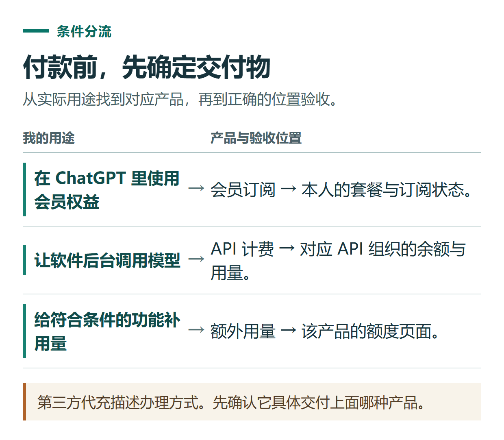
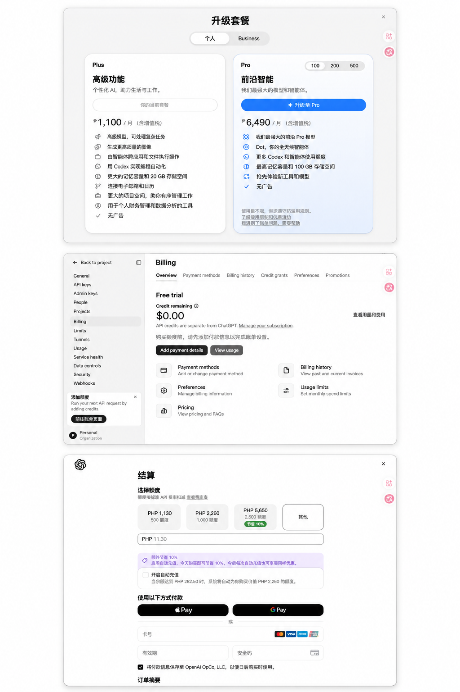
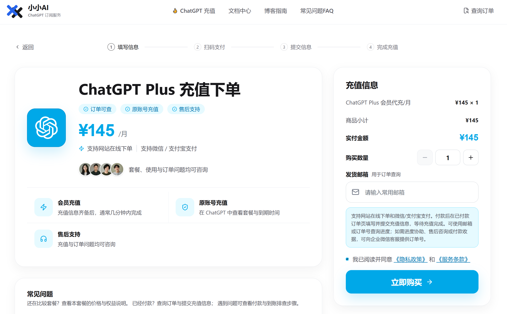

# ChatGPT 充值到底买什么？会员订阅、API 余额与代充的区别

[知识库首页](../README.md) · [套餐、充值与账单](../catalog/topics/subscription.md) · [已上线教程](../README.md)

资料核对：2026-11-03。适用对象：准备购买或续费，但不确定商品类型的读者。

> **先看结论：** “ChatGPT 充值”是一个容易混淆的说法。有人指的是开通 Plus，有人想给开发软件使用的 API 账户加余额，还有人需要额外的任务额度。付款前先把交付物说清楚，比先比较便宜多少更重要。

<details>
<summary>本篇导航</summary>

- [一、用一张表分清楚](#section-01)
- [二、三个例子，判断自己要买什么](#section-02)
- [三、“代充”描述的是办理方式](#section-03)
- [四、付款前可直接复制的确认清单](#section-04)
- [五、还没决定套餐，先完成这一步](#section-05)

</details>

<a id="section-01"></a>

## 一、用一张表分清楚

| 商品或服务 | 主要解决什么需求 | 验收时看哪里 |
|---|---|---|
| ChatGPT 会员订阅 | 使用对应套餐的 ChatGPT 权益 | 本人账号的套餐与订阅页面 |
| OpenAI API 余额 | 软件调用 API 时的计费需求 | API 平台对应组织的账单与余额 |
| ChatGPT / Codex 相关额外额度 | 符合条件的功能在原有用量之外继续使用 | 对应产品的额度页面 |
| 会员代充服务 | 第三方协助办理约定的会员产品 | 服务订单，以及官方账号最终状态 |

OpenAI 当前将 ChatGPT 与 API 平台分别计费，API 余额也与 ChatGPT 内的额度分开。符合条件的订阅可能有 API 促销额度权益，但应按具体活动绑定和领取，不能理解为两边余额互通。[官方账单说明](https://help.openai.com/en/articles/9039756-managing-billing-for-chatgpt-and-the-api-platform)



*第三方代充描述办理方式。先确认它具体交付上面哪种产品。*

<a id="section-02"></a>

## 二、三个例子，判断自己要买什么

**“我想在 ChatGPT 里写文章、读文件。”** 先比较会员套餐，而不是去 API 平台充值。是否需要付费，取决于实际功能和用量需求。

**“我写了一个网站，想让后台调用模型回复用户。”** 这是 API 使用场景。需要确认 API 组织、计费方式和软件接入，购买个人 ChatGPT 会员不能直接替代这些准备。

**“我已经有会员，某个任务工具提示额度用完。”** 先记录具体产品、模式及额度提示。不要看到“额度”两个字就购买 API 余额，应该按该功能的官方额度说明处理。

如果卖家只写“GPT充值100元”，但没有套餐、周期、到账位置和验收方法，信息还不够完整。先问清，再付款。



*上方为 ChatGPT 套餐页面，中间为 API 账单页面，下方展示额度结算界面。请按页面标明的产品和用途核对，图中的金额和状态仅供示例。*

<a id="section-03"></a>

## 三、“代充”描述的是办理方式

代充不是 OpenAI 的另一个会员档位。你购买的是第三方约定的办理服务，最终还应核对自己的官方账号获得了什么。

例如，订单约定为某个个人会员套餐，验收就要看目标账号、准确套餐名称和有效周期。收到一句“已经处理好了”，或在另一个网站能聊天，都不足以证明该订单的目标会员已生效。

订阅条件、功能范围、使用限制仍由产品规则决定。第三方服务不能通过一句“包开通”改变账号地区条件或保证所有功能一直可用。

<a id="section-04"></a>

## 四、付款前可直接复制的确认清单

```text
我想办理的是：ChatGPT会员 / API余额 / 其他指定额度
目标账号或API组织：通过约定渠道核对，不在公开评论发完整信息
套餐全名或到账额度：
服务周期：
总支付金额及币种：
已有订阅及原付款渠道：
是否自动续费，在哪里管理：
交付后通过哪个官方页面验收：
未交付、交付不符和退款分别如何处理：
```

如果办理方要求提供信息，先确认用途和必要性。密码、登录验证码以及可直接访问账号的凭证，不应因为换了一个名称就被当作普通订单信息；具体授权应在你理解权限和用途后决定。



*小小AI 下单页面示例。实际商品、金额及交付说明以结账页面为准。*

<a id="section-05"></a>

## 五、还没决定套餐，先完成这一步

把自己的用途写成一句话：“我主要用它做什么，每周多少次，现在卡在哪里。”带着这句话阅读[套餐选择指南](chatgpt-plans-comparison.md)，更容易判断。

需要第三方办理时，可从[小小AI充值中心](https://xiaoxiao.pro/shop?utm_source=github&utm_medium=referral&utm_campaign=chatgpt_guide&utm_content=a05_shop)查看产品分类。小小AI是独立第三方服务方；具体商品和服务条件按当前页面及订单确认内容核对。完整的下单与验收方法见[小小AI会员办理指南](chatgpt-topup-order-guide.md)。

## 接下来按你的情况继续

- [套餐怎么选](chatgpt-plans-comparison.md)：选出待比较的档位，明确升级希望解决的限制。
- 用量与上限：识别限制类型，按实际任务安排用量和升级判断。

[返回套餐、充值与账单专题](../catalog/topics/subscription.md) · [完整目录](../catalog/ALL_ARTICLES.md)
