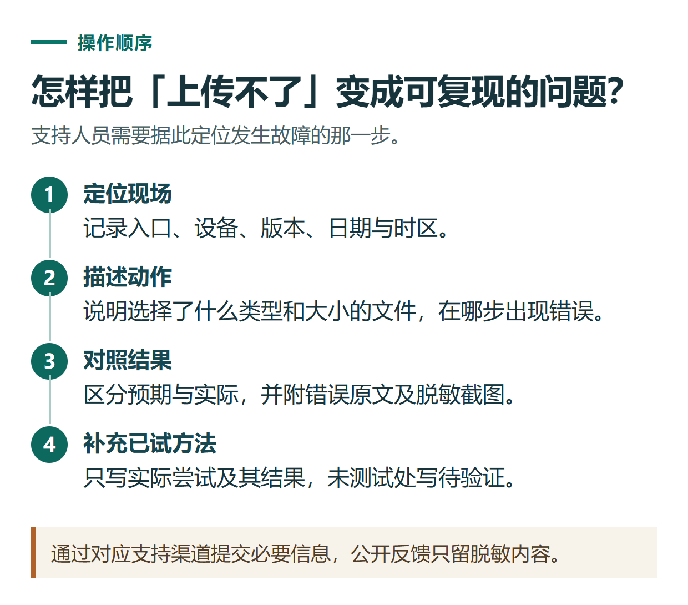

# 如何联系ChatGPT官方支持：故障描述、截图和求助材料模板

[知识库首页](../README.md) · [登录、隐私与账号](../catalog/topics/accounts.md) · [按问题找答案](../catalog/TASKS.md)

资料核对：2026-11-03。适用环境：OpenAI官方帮助中心；应用商店与独立第三方订单需按实际责任方处理。

> **先看结论：** 有效的求助材料应让对方知道：哪里出了问题、什么时候发生、你做过什么，以及预期与实际结果有什么不同。“不能用了，快帮我看看”通常还需要来回补充很多信息。

<details>
<summary>本篇导航</summary>

- [一、先确认问题该交给谁](#section-01)
- [二、先收集六类信息](#section-02)
- [三、可以直接填写的描述模板](#section-03)
- [四、只有需要时再提供诊断文件](#section-04)

</details>

<a id="section-01"></a>

## 一、先确认问题该交给谁

官方账号、功能与网页订阅问题，可以从[OpenAI帮助中心](https://help.openai.com/)右下角聊天入口发起请求，按提示选择问题类型。入口通常先由虚拟助手接待，并不保证立即转人工。可以先用中文清楚描述；是否补充其他语言按支持过程需要决定。[官方联系支持说明](https://help.openai.com/en/articles/6614161-how-can-i-contact-support)

Apple订阅的退款需要按Apple流程处理；其他渠道与退款路径见[取消续费与退款](chatgpt-cancel-refund.md)。独立第三方的订单进度、服务费及约定履行，应同时向该商家的真实售后渠道核实。

<a id="section-02"></a>

## 二、先收集六类信息

1. **问题位置：** 网页、手机、桌面端，普通对话还是具体工作区、功能。
2. **时间：** 日期、时间和时区，例如北京时间UTC+8。
3. **环境：** 操作系统、浏览器或应用版本，以及网络环境是否有变化。
4. **复现步骤：** 从哪个入口、选择了什么、在哪一步出现问题。
5. **实际结果：** 错误原文、是否持续发生；不知道错误原因就写不知道。
6. **已尝试操作：** 刷新、重新登录或更换文件等，只写确实做过的检查。

账号邮箱、订阅渠道和相关订单信息，可在官方支持要求时通过其私密渠道提供。公开论坛或GitHub问题区不应放完整邮箱、订单、聊天内容，更不应放密码和验证码。



*通过对应支持渠道提交必要信息，公开反馈只留脱敏内容。*

<a id="section-03"></a>

## 三、可以直接填写的描述模板

下面以文件上传问题示范结构，方括号内容需要替换；不是已经发生或已经完成排查的记录。

```text
问题：我在[具体入口]上传[文件类型、大小]时遇到[错误原文]。
首次发现：[日期、时间、时区]。
环境：[设备系统、浏览器或应用版本、工作区类型]。

复现步骤：
1. 打开[页面或功能]。
2. 点击[按钮]，选择[已脱敏的文件说明]。
3. 出现[实际结果]。

预期结果：[希望完成的操作]。
出现频率：[每次/偶发/只发生一次，按真实情况填写]。
已尝试：[实际执行过的操作与结果；没有则写尚未尝试]。
附件：[已检查的脱敏截图；是否有可用于复现的非敏感样本]。
希望协助：[核查账号权限、确认错误原因或指导下一步]。
```

不确定文件大小就先查看文件属性，不随意填写一个数值。若原文件含客户数据，可以另做同格式的无敏感样本，再记录该样本是否同样失败；不能把“尚未测试”写成“也无法上传”。

<a id="section-04"></a>

## 四、只有需要时再提供诊断文件

支持人员可能要求浏览器网络记录等诊断材料。HAR文件可能包含敏感信息，应先确认请求来自官方渠道，再按指引收集和检查；不要把完整记录直接贴到公开仓库。正文模板不要求你主动录制或上传HAR。

提交后保存工单上下文，补充新信息时说明与前一次的差别。没有收到解决确认前，把状态记为“等待处理”，不把自动回复等同于退款批准或故障解决。

## 接下来按你的情况继续

- [付款失败或会员未生效](chatgpt-payment-troubleshooting.md)：找到所属问题分支并准备有效反馈材料。
- [密码恢复与更换邮箱](chatgpt-login-recovery-email.md)：按原认证方式恢复登录并检查自助换邮箱资格。

[返回登录、隐私与账号专题](../catalog/topics/accounts.md) · [完整文章索引](../catalog/ALL_ARTICLES.md)
