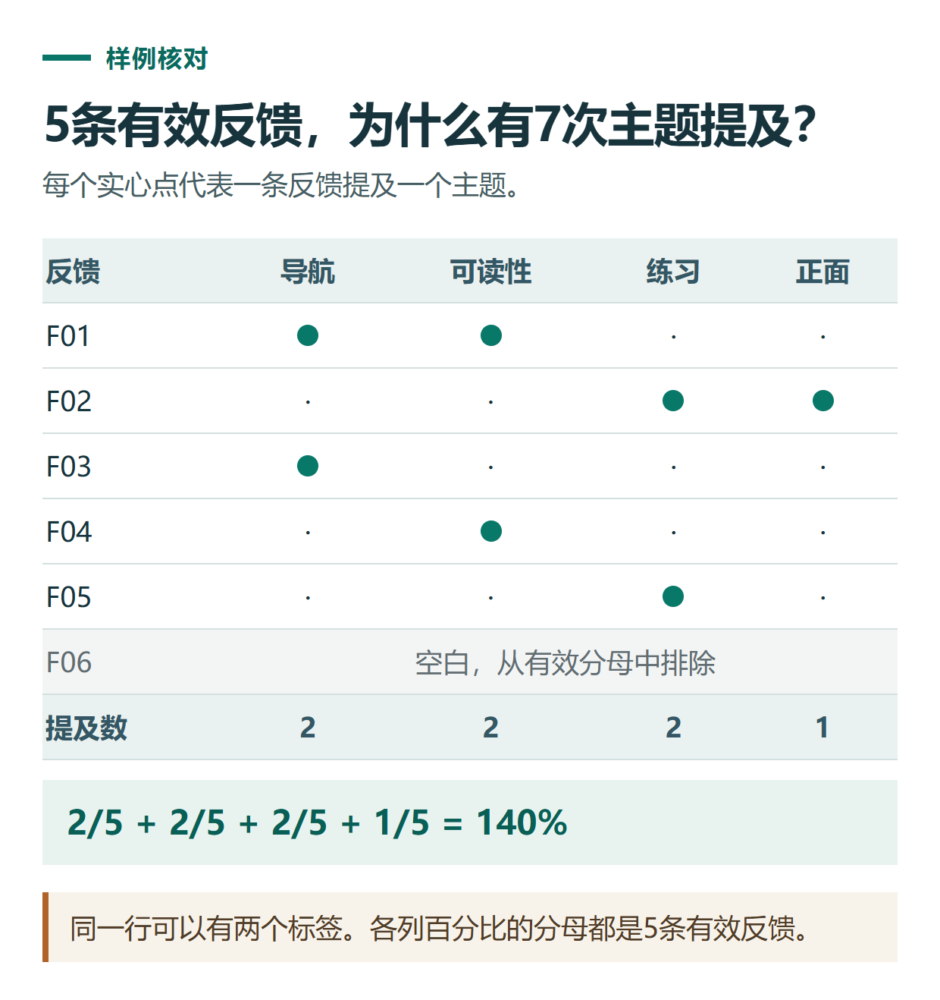

# ChatGPT 分析问卷和客户反馈：分类、统计与保留原话的完整练习

[知识库首页](../README.md) · [文件、表格与图表](../catalog/topics/data-files.md) · [按问题找答案](../catalog/TASKS.md)

资料核对：2026-11-03。适用环境：文本或表格分析；下文反馈全部为原创虚构，不代表真实用户评价。

> **先看结论：** 分析反馈不只是让ChatGPT写一段“用户整体满意”。先保留每条原话，再明确分类规则和统计分母，才能知道哪些结论确实来自材料。

<details>
<summary>本篇导航</summary>

- [一、准备一份能追溯的样本](#section-01)
- [二、先定义标签，再编码](#section-02)
- [三、计算主题比例时写清分母](#section-03)
- [四、把分析变成可执行的改进](#section-04)
- [五、大量反馈怎样扩展](#section-05)

</details>

<a id="section-01"></a>

## 一、准备一份能追溯的样本

| 编号 | 反馈原话 |
|---|---|
| F01 | 资料难找，截图太小。 |
| F02 | 步骤清楚，但想要原始练习材料。 |
| F03 | 入口找不到。 |
| F04 | 截图太小，手机上看不清。 |
| F05 | 希望有更多可照着做的练习。 |
| F06 | 空白，未填写 |

先告诉它：F06为空白，不计入有效文字反馈；每条反馈可以有多个主题。官方数据分析支持对上传材料整理、归类和生成表格，具体编码规则由本次任务确定。[数据分析说明](https://help.openai.com/en/articles/8437071-data-analysis-with-chatgpt)

<a id="section-02"></a>

## 二、先定义标签，再编码

```text
按以下主题标记每条有效反馈：
导航与查找、截图可读性、练习材料、正面评价。
允许一条反馈有多个标签，附对应原话。
没有提到的内容不推断；F06保留为无效空白，不参与主题比例。
先输出逐条编码表，不做整体满意度结论。
```

人工参考：导航与查找对应F01、F03；截图可读性对应F01、F04；练习材料对应F02、F05；正面评价对应F02。一个人同时肯定步骤又提出改进，并不矛盾。

<a id="section-03"></a>

## 三、计算主题比例时写清分母

有效反馈共5条。导航、可读性和练习材料各有2条，占有效反馈40%；正面评价1条，占20%。因为采用多标签，比例相加可以超过100%。

这里统计的是“提及该主题的反馈条数”，不是所有用户的满意度，也不代表每条意见的重要性相同。不能根据5条练习材料写出真实市场结论。



*本篇练习图。同一行可以有两个标签。各列百分比的分母都是5条有效反馈。*

<a id="section-04"></a>

## 四、把分析变成可执行的改进

```text
根据编码表提出3项可验证改进。
每项写：对应反馈编号、具体改动、如何检查是否完成。
只给建议，不声称已经实施或一定提升满意度。
保留一条需要进一步询问用户的问题。
```

例如，针对F01、F03，可以建议增加任务导航，并让新读者尝试找到指定教程；针对截图问题，可检查手机显示尺寸；针对练习需求，可补完整输入材料和参考答案。

<a id="section-05"></a>

## 五、大量反馈怎样扩展

先用一小批确定标签定义，给容易混淆的边界加例子；再处理完整数据。抽查重复意见、讽刺表达、多个主题和空白行，必要时人工修订。

保留原话、标签、修订理由和版本，便于后来解释结论。准备展示分析时，可参考[图表与指标口径](chatgpt-charts-dashboard.md)；原表有重复和空值时，先看[数据清洗](chatgpt-excel-data-cleaning.md)。

## 接下来按你的情况继续

- [清洗表格数据](chatgpt-excel-data-cleaning.md)：处理重复、日期、空值、金额和退款并保留清洗记录。
- [六平台内容排期](chatgpt-content-calendar.md)：将一个完整主题改编成六个平台的具体交付。

[返回文件、表格与图表专题](../catalog/topics/data-files.md) · [完整文章索引](../catalog/ALL_ARTICLES.md)
