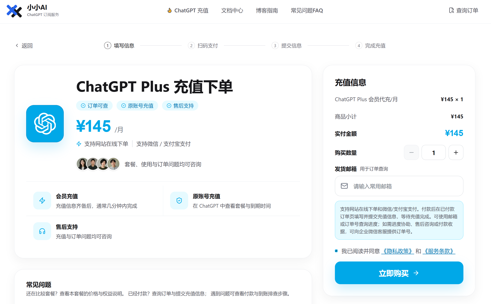
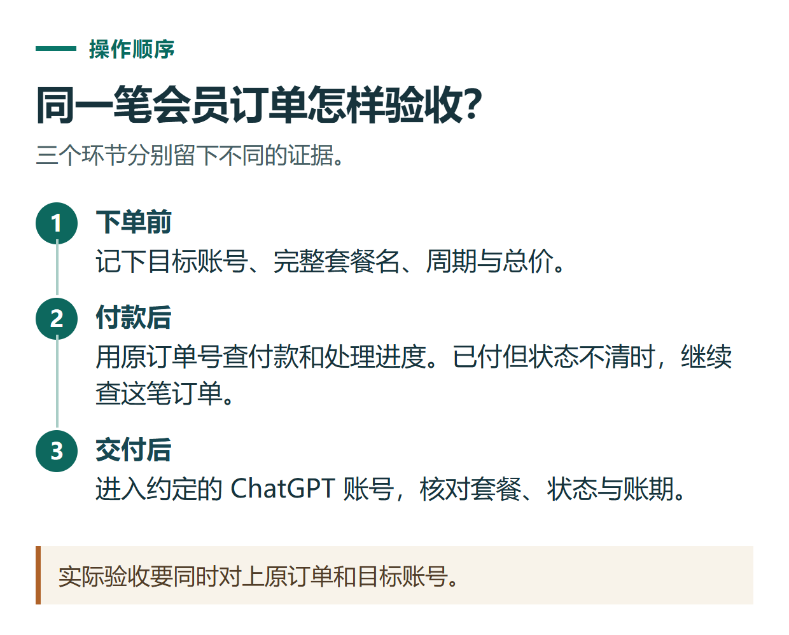
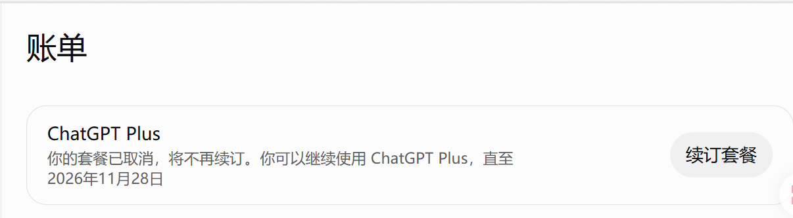

# 小小AI ChatGPT 会员代充指南：下单、查询进度与交付验收

[知识库首页](../README.md) · [套餐、充值与账单](../catalog/topics/subscription.md) · [已上线教程](../README.md)

资料核对：2026-11-03。本文根据小小AI公开服务页面整理，以 Plus 订单为例；没有进行真实付款或代充实测。

> **先看结论：** 准备通过小小AI办理 ChatGPT 会员时，应先确认自己的账号与所需套餐，再下单付款，最后回到 ChatGPT 官方账号验收。订单显示完成和账号权益实际生效，需要分别查看。

小小AI为独立第三方服务方，与 OpenAI 无隶属关系。

<details>
<summary>本篇导航</summary>

- [一、付款前，把这四项确认好](#section-01)
- [二、从网站进入对应商品](#section-02)
- [三、查询进度，不要反复创建订单](#section-03)
- [四、收到交付通知后，回官方账号验收](#section-04)
- [五、遇到问题，直接提供这段信息](#section-05)

</details>

<a id="section-01"></a>

## 一、付款前，把这四项确认好

**目标账号。** 先登录自己要充值的 ChatGPT 账号，确认邮箱或账号标识。不要一边登录甲账号，一边给乙账号办理。

**准确套餐。** 记录套餐全名和周期；Pro 不同档位不能只写成一个笼统的“Pro”。尚未确定的，先读[套餐选择指南](chatgpt-plans-comparison.md)。

**已有订阅。** 如果原来通过网页、Apple 或 Google Play订阅，先确认当前状态和下一次扣费时间，向客服说明是否需要续费或变更。

**总价与售后。** 查看当前订单金额、交付说明和[售后政策](https://xiaoxiao.pro/policy)。不同商品的适用范围要逐项确认，不把一个套餐的说明自动套用到全部商品。

<a id="section-02"></a>

## 二、从网站进入对应商品

打开[小小AI充值中心](https://xiaoxiao.pro/shop?utm_source=github&utm_medium=referral&utm_campaign=chatgpt_guide&utm_content=a06_shop)，选择需要的会员，再进入对应订单页面。以 [Plus下单页](https://xiaoxiao.pro/getgpt-plus?utm_source=github&utm_medium=referral&utm_campaign=chatgpt_guide&utm_content=a06_getgpt-plus)为例，公开页面展示了填写信息、扫码支付、提交信息与完成充值的流程，并提供微信、支付宝支付入口。

页面中的“发货邮箱”用于订单查询。它与最终要充值的 ChatGPT 目标账号不是天然相同的概念，付款后仍需要按订单指引核对目标账号信息。



*下单前核对商品、数量、金额和用于查询的邮箱。截图展示的是页面示例，实际内容以订单为准。*

确认商品、数量和金额，阅读页面所列条款后再支付。如果不清楚购买数量对应的交付方式，先询问客服，不自行把数量理解为连续订阅月数。

付款后按已付款订单页继续提交必要信息。本文没有进入真实已付款订单，因此不替代订单内的具体字段说明，也不编造某个必须点击的授权按钮。对不理解的信息用途，应先通过网站列明的客服核实。

<a id="section-03"></a>

## 三、查询进度，不要反复创建订单

保留订单号及付款记录，进入[小小AI订单查询](https://xiaoxiao.pro/orders?utm_source=github&utm_medium=referral&utm_campaign=chatgpt_guide&utm_content=a06_orders)，选择邮箱或订单号查询方式。核对的是同一笔订单，尤其注意多次打开支付页面时是否产生了不同订单号。

如果付款已完成，但订单状态与预期不一致，先反馈原订单。重复购买不等于催单，可能增加核对难度。

<a id="section-04"></a>

## 四、收到交付通知后，回官方账号验收

依次检查下面几项，并保存一张打码后的状态截图：

| 核对项 | 应确认的内容 |
|---|---|
| 目标账号 | 当前登录账号与订单约定一致 |
| 套餐 | 名称及档位与付款前确认一致 |
| 状态 | 官方页面已经显示相应订阅状态 |
| 周期 | 对照到期日或账期，区分下次扣费日与权益截止日 |
| 续费 | 明确本次订单及原订阅是否仍有后续扣费安排 |

小小AI公开页面将此类代充描述为一次性办理；自己的原有订阅仍应单独核对。最终以订单确认内容、官方账号状态与当前服务规则为准。[服务方交付与售后说明](https://xiaoxiao.pro/policy)

可以再完成一个自己会用的小任务，确认账号能正常进入产品。但某项功能未出现，不一定表示套餐未生效；功能开放范围和会员状态应分别核查。



*实际验收要同时对上原订单和目标账号。*



*截图中的套餐已取消续订，页面同时显示仍可使用的截止日期。具体续费状态和到期时间以本人账号为准。*

<a id="section-05"></a>

## 五、遇到问题，直接提供这段信息

```text
问题类型：付款状态 / 提交信息 / 套餐未生效 / 套餐不符 / 其他
订单号：通过原客服渠道提交
约定套餐及周期：
付款时间和金额：
当前订单状态：
ChatGPT官方页面当前显示：
已经尝试的操作：
附件：脱敏后的订单和官方页面截图
```

退款与售后按对应订单和现行政策核验，不把“可以提出申请”理解为所有情形都保证退款。需要办理时，可先从[小小AI会员服务页面](https://xiaoxiao.pro/shop?utm_source=github&utm_medium=referral&utm_campaign=chatgpt_guide&utm_content=a06_shop)确认产品；已付款的问题优先围绕原订单处理。

## 接下来按你的情况继续

- 账单与重复扣款：按渠道找凭证并判断两笔交易的状态。
- [付款失败或会员未生效](chatgpt-payment-troubleshooting.md)：找到所属问题分支并准备有效反馈材料。

[返回套餐、充值与账单专题](../catalog/topics/subscription.md) · [完整目录](../catalog/ALL_ARTICLES.md)
