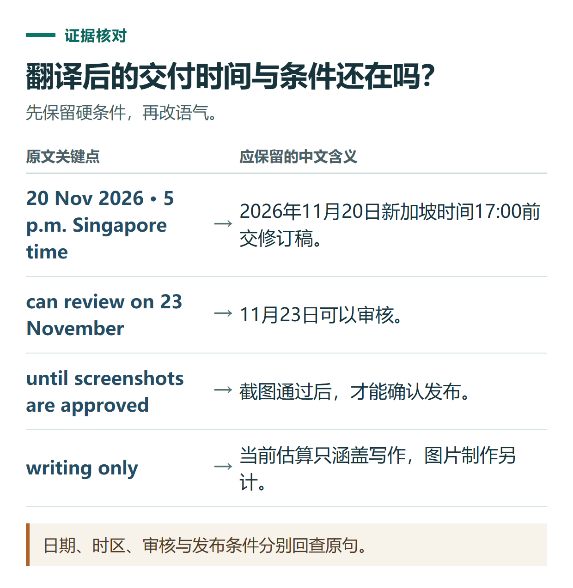

# ChatGPT 翻译与润色教程：保留日期、语气和条件，避免越改越失真

[知识库首页](../README.md) · [学习、求职与表达](../catalog/topics/learning.md) · [按问题找答案](../catalog/TASKS.md)

资料核对：2026-11-03。适用环境：文字对话；邮件材料为原创虚构练习。

> **先看结论：** 翻译不只是把单词换成另一种语言。工作邮件里的截止时间、是否确定、包含范围和条件关系，往往比句子是否漂亮更重要。先做准确版本，再做适合读者的润色，最后逐项核对事实。

<details>
<summary>本篇导航</summary>

- [一、先告诉它用途与不能改的内容](#section-01)
- [二、用参考译文核对核心事实](#section-02)
- [三、第二轮才调整语气](#section-03)
- [四、把核对过程变成一张表](#section-04)
- [五、长期使用时准备自己的术语表](#section-05)

</details>

<a id="section-01"></a>

## 一、先告诉它用途与不能改的内容

下面是一段虚构英文沟通材料：

```text
Please send the revised draft by 5 p.m. Singapore time on 20 November 2026.
We can review it on 23 November, but cannot confirm publication until the screenshots are approved.
The current estimate covers writing only; image production is excluded.
```

第一轮提示词：

```text
请把这段英文翻译成给中文同事看的工作说明。
先保证准确，保留日期、时间、时区和条件关系。
区分“可以审核”与“已经确认发布”。
estimate的具体业务含义如果不明确，请在正文外说明，不擅自补金额。
不要添加称呼、落款或额外承诺。
```

任务背景与保留条件有助于限定改写范围，方法可参考[官方提示指南](https://learn.chatgpt.com/docs/prompting)；本篇翻译示例由编辑编写，不是实测输出。

<a id="section-02"></a>

## 二、用参考译文核对核心事实

> 请在2026年11月20日新加坡时间下午5点前发送修订稿。我们可以在11月23日审核，但截图获批之前，无法确认发布安排。当前估算仅包含写作，不包含图片制作。

这里“estimate”可能指费用估算、工时估算或其他估算，应根据真实沟通背景确认。原文没有金额，译文就不能自己加价。

判断重点是：20日交稿、23日可以审核、发布仍有截图批准这一前提、图片制作不包含在当前估算里。不能把“可以审核”写成“保证当天上线”。



*日期、时区、审核与发布条件分别回查原句。*

<a id="section-03"></a>

## 三、第二轮才调整语气

如果要发工作群，可以继续要求：

```text
基于已核对译文，改成一段自然简洁的中文工作群说明。
所有日期、时区、条件和范围保留，不新增保证。
把“无法确认发布安排”写得礼貌一些，但不能改成已经同意发布。
```

润色可以改变语气，但不能改变义务或确定程度。像“可能”“计划”“需先确认”“不包含”等词，往往承载关键条件，不应为了流畅被删掉。

<a id="section-04"></a>

## 四、把核对过程变成一张表

```text
请把原文中的事实逐项列出来，并对照最终中文版本。
表头：事实或条件、英文依据、中文对应、是否一致。
特别检查日期、时间、可审核与可发布的区别，以及不包含图片制作。
发现问题先指出，不要自行猜业务背景。
```

自己再看一遍表格。模型翻译后由同一个模型检查，仍可能重复原来的误解；重要沟通需要对照原文，必要时请熟悉业务或语言的人复核。

<a id="section-05"></a>

## 五、长期使用时准备自己的术语表

```text
品牌名：按原文保留，不自行翻译
draft：初稿或草稿，按文章阶段统一
review：审核或审阅，按实际角色确定
publish：发布
approved：已获确认或批准，不等同于已执行
```

真实团队可以把已确认术语放到项目资料中，要求以后按同一套用法处理。遇到新词先标记，再决定是否加入；不要一次让它生成几百个未经业务确认的“标准译法”。

翻译后需要对比版本，可用[文档差异检查](chatgpt-compare-documents.md)；需要长期管理术语和写作偏好，可使用[项目与自定义指令](chatgpt-projects-memory-instructions.md)。

## 接下来按你的情况继续

- [简历与面试](chatgpt-resume-interview.md)：按真实经历匹配岗位，并用追问练习验证表达。
- [提示词与多轮修改](chatgpt-prompting-practice.md)：完成活动文案与逐项事实核对。

[返回学习、求职与表达专题](../catalog/topics/learning.md) · [完整文章索引](../catalog/ALL_ARTICLES.md)
