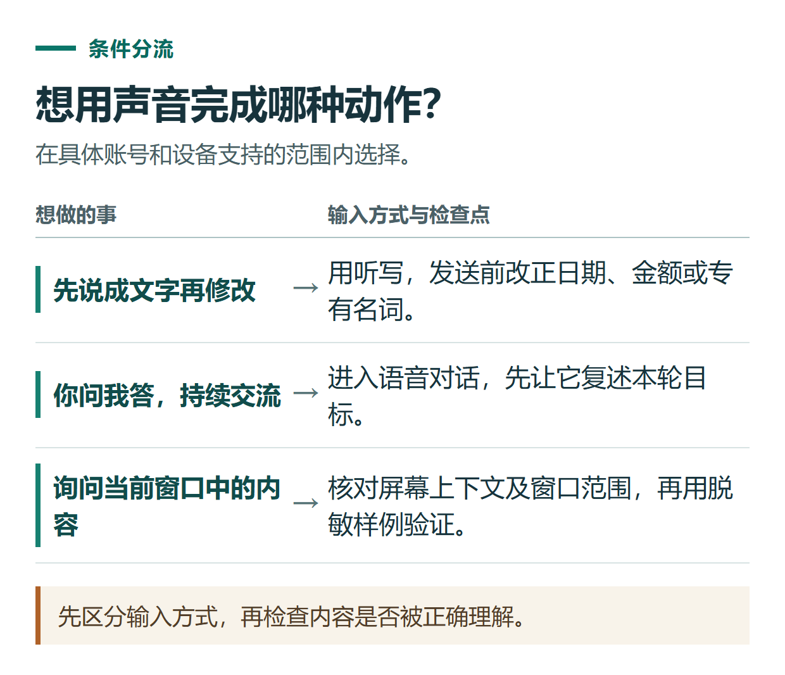

# ChatGPT 听写、语音对话与屏幕上下文有什么区别？按任务选择输入方式

[知识库首页](../README.md) · [语音、听写与录音](../catalog/topics/audio.md) · [按问题找答案](../catalog/TASKS.md)

资料核对：2026-11-03。适用环境：听写以实际客户端入口为准；屏幕上下文步骤针对支持该功能的macOS桌面端。

> **先看结论：** 想口述一段问题、边聊边追问、让它参考当前窗口，是三种不同任务。先选对入口，再检查实际发送的内容，可以减少“我只是想输入文字，却直接开始聊天”的困惑。

<details>
<summary>本篇导航</summary>

- [一、三种输入方式怎么选](#section-01)
- [二、先用听写输入一段明确要求](#section-02)
- [三、屏幕上下文不等于只读屏幕上那一小块](#section-03)
- [四、用一张虚构任务表练习看屏幕](#section-04)
- [五、没有声音或没有屏幕入口](#section-05)

</details>

<a id="section-01"></a>

## 一、三种输入方式怎么选

| 需求 | 适合的方式 | 重点检查 |
|---|---|---|
| 口述后改字再发送 | 听写Dictation | 转写中的数字和专有名词 |
| 持续开口交流、打断追问 | Voice语音对话 | 是否进入正确对话和任务 |
| 参考当前应用窗口解释问题 | 可用的屏幕上下文 | 实际被读取的窗口及其内容 |

听写会把录音返回为可编辑文字，发送前可以修改。[官方听写说明](https://help.openai.com/en/articles/12168547-voice-dictation-faq)



*先区分输入方式，再检查内容是否被正确理解。*

<a id="section-02"></a>

## 二、先用听写输入一段明确要求

点击实际输入区的麦克风听写入口，口述以下原创练习：

> 请把“周四晚上七点半，八人参加，活动四十分钟，地点待确认”整理成通知。不要添加报名链接。

转写完成后先检查“七点半”是否识别成正确时间，人数与时长是否混淆，“待确认”和“不要”是否丢失。修正文字后再发送。

如果直接进入持续语音对话，说明使用的是另一种入口。退出后查看输入区说明，不用按钮形状相似就推定它们作用相同。

<a id="section-03"></a>

## 三、屏幕上下文不等于只读屏幕上那一小块

在符合条件的macOS桌面环境，官方说明可在 **Settings → Voice → Screen context** 开启，然后在语音中请它查看当前窗口。系统可能要求屏幕与系统音频、辅助功能权限。[桌面Voice说明](https://learn.chatgpt.com/docs/features/voice)

这里获取的Appshot可能包含窗口图像和可访问文字，甚至包含可见滚动区域之外的内容。因此，练习前关闭真实客户页面，打开一份只有虚构信息的文档，不只遮住当前可见的一行。

<a id="section-04"></a>

## 四、用一张虚构任务表练习看屏幕

自己准备以下三行表格并放到前台窗口：

```text
文章A：已审稿，缺封面
文章B：初稿完成，待审稿
文章C：尚未开始
```

在支持的语音环境说明：

> 请看当前这张练习表，只解释三篇文章分别处于什么阶段。不要操作页面，也不要把初稿完成说成已经发布。

确认它描述的是前台练习窗口。如果读到另一个应用，先停止并重新指定目标。需要修改文件时，应另行说明可修改的范围；能看见不等于已经获得随意改动所有资料的意图。

<a id="section-05"></a>

## 五、没有声音或没有屏幕入口

检查是否正在另一个窗口进行语音、麦克风是否被允许、账号与组织是否开放该功能。屏幕上下文没有开放时，可以直接上传截图，配上明确的问题。

语音输出需要复盘时参考[口语与文字复盘](chatgpt-voice-practice.md)；需要图片里的文字和表格，则使用[图片识别教程](chatgpt-image-understanding-ocr.md)。

## 接下来按你的情况继续

- [语音练习](chatgpt-voice-practice.md)：完成5问以内练习并记录3句表达。
- [图片识别与OCR](chatgpt-image-understanding-ocr.md)：把图片转成可核对文字和表格，标出识别不清的信息。

[返回语音、听写与录音专题](../catalog/topics/audio.md) · [完整文章索引](../catalog/ALL_ARTICLES.md)
