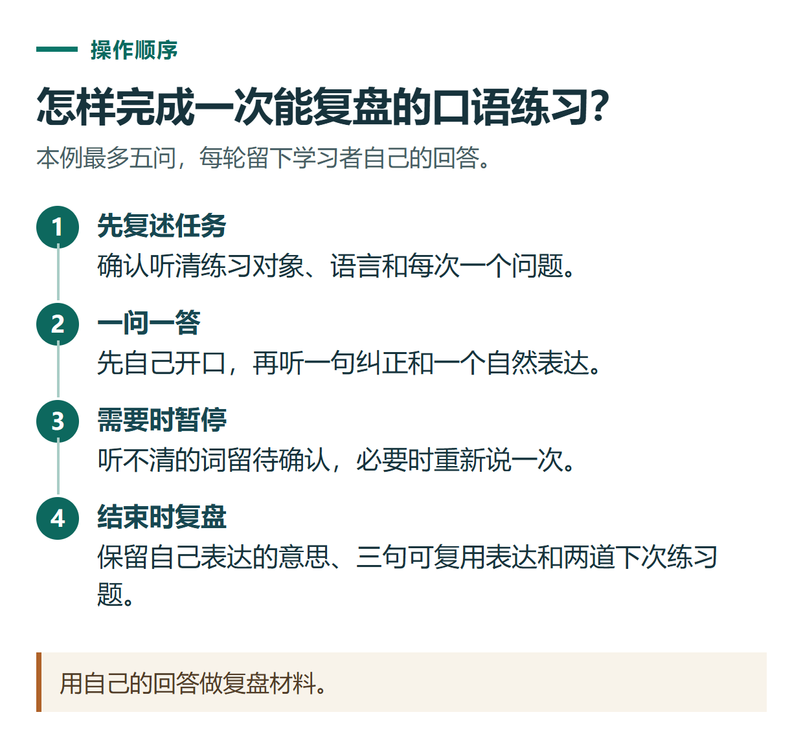

# ChatGPT 语音怎么用？手机开口对话、英语练习与文字复盘

[知识库首页](../README.md) · [语音、听写与录音](../catalog/topics/audio.md) · [按问题找答案](../catalog/TASKS.md)

资料核对：2026-11-03。适用环境：ChatGPT网页及手机端；桌面语音的用量规则不在本文比较范围内。

> **先看结论：** ChatGPT语音适合来回讨论、口头梳理想法和语言练习。若只是想把一句话变成文字后编辑发送，使用听写；如果希望它听你说并用语音回应，使用语音对话。

<details>
<summary>本篇导航</summary>

- [一、先找到正确的入口](#section-01)
- [二、先用中文验证是否听清楚](#section-02)
- [三、一套可以直接使用的英语练习](#section-03)
- [四、结束时一定做文字复盘](#section-04)
- [五、语音记录能不能直接当会议纪要](#section-05)
- [六、常见故障怎样处理](#section-06)

</details>

<a id="section-01"></a>

## 一、先找到正确的入口

在手机应用的消息栏选择语音图标，按提示允许麦克风访问并开始说话；网页版也可以从输入区的语音入口开始，浏览器会请求麦克风权限。

当前官方说明区分Live、Advanced和Standard等语音方式，实际选项受账号条件影响。Live支持自然来回交流，但目前不支持视频或屏幕共享；相关移动能力需查看符合条件的Advanced入口。[ChatGPT官方语音说明](https://help.openai.com/en/articles/20001274-chatgpt-voice)

<a id="section-02"></a>

## 二、先用中文验证是否听清楚

第一次不要直接做复杂任务，可以说：

```text
我们先测试一下语音。
请用中文重复我的任务要求，不要开始执行：
我要练习三分钟英文自我介绍，希望你每次只问一个问题。
```

听它是否正确理解了语言、时长和“每次一个问题”。如果识别不对，先换安静环境、检查所选麦克风，必要时在设置里调整主要语言，再进入正式练习。

<a id="section-03"></a>

## 三、一套可以直接使用的英语练习

```text
请和我做一轮面向初学者的英文自我介绍练习。
场景是第一次和新同事见面，最多问我5个问题，每次只问一个。
我回答后，先用一句中文指出最值得改进的表达，
再给一个简短自然的英文版本，然后问下一题。
如果我说“暂停”，先停下来；如果我说“复盘”，结束问答并整理学习记录。
不要替我编造工作经历。
```

为了开始练习，可以用虚构身份：“I work on a Chinese technology blog. I write tutorials for beginners.” 真实使用时换成自己的经历，不需要把公司名称等私人信息全部说出来。

若觉得节奏太快，可以说：“下一题用更简单的词，等我回答完再纠正。”如果不断被打断，就切回文字，把关键要求重新写清楚。口头要求能帮助调整节奏，但不保证每一次停顿都被准确识别。



*用自己的回答做复盘材料。*

<a id="section-04"></a>

## 四、结束时一定做文字复盘

练完后发送：

```text
现在结束练习。
请整理：我表达的核心意思、建议使用的3句英文、下一次要练习的2个问题。
不要添加我没有说过的履历。
如果某句话听不清，标为“需要我确认”，不要猜。
```

可以把3句英文保存到自己的学习笔记，下一次先自己说一遍，再请它指出差异。一次只练一个场景，更容易知道自己有没有进步。

<a id="section-05"></a>

## 五、语音记录能不能直接当会议纪要

不能只因为对话留下了文字，就把它当成准确逐字稿。官方提示语音转写可能与实际说话不同，背景声音和同时说话也会影响识别。[语音转写与使用说明](https://help.openai.com/en/articles/20001274-chatgpt-voice)

如果要整理多人会议，先取得合适的原始记录，再按[会议纪要教程](chatgpt-meeting-weekly-report.md)核对负责人、日期和决定。尤其不要把语音听错的名字直接写入正式工作安排。

<a id="section-06"></a>

## 六、常见故障怎样处理

**听不到声音：** 检查系统音量、耳机连接和当前输出设备，再进行短句测试。

**它听不到你：** 核对浏览器或应用的麦克风权限，确认选中的输入设备正常。

**说一半结束：** 看页面是否出现用量或会话限制提示，保存已完成内容，再根据提示继续文字或稍后使用。

**手机和桌面规则不同：** 不直接套用另一平台的时长或额度表，查看当前入口及账号提示。准备升级时，应先明确自己主要使用的语音场景，再参考[套餐选择](chatgpt-plans-comparison.md)。

## 接下来按你的情况继续

- [听写与屏幕上下文](chatgpt-voice-dictation-screen.md)：选用听写、实时语音或屏幕上下文并核对输入。
- [学习模式](chatgpt-study-mode.md)：按当前入口启用学习模式，通过提问和反馈掌握一个概念。

[返回语音、听写与录音专题](../catalog/topics/audio.md) · [完整文章索引](../catalog/ALL_ARTICLES.md)
