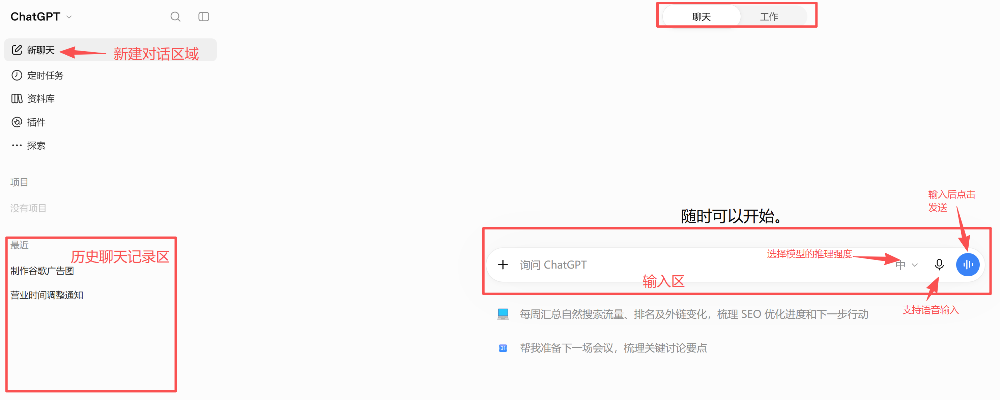

# ChatGPT 网页版怎么用：从第一条提问到保存可用结果

[知识库首页](../README.md) · [网页、手机与桌面](../ROADMAP.md#module-04) · [已上线教程](../README.md)

资料核对：2026-11-03。适用环境：ChatGPT 网页版；练习材料为原创虚构示例。

> **先看结论：** 第一次打开 ChatGPT，不必把所有按钮都研究完。先完成一件小事：把散乱信息整理成一段能直接使用的文字，再学会追问修改和检查结果。

<details>
<summary>本篇导航</summary>

- [一、认识最常用的三个区域](#section-01)
- [二、复制材料，完成第一次任务](#section-02)
- [三、用追问修改，不必每次重来](#section-03)
- [四、复制出去之前检查四项](#section-04)
- [常见问题](#section-05)

</details>

<a id="section-01"></a>

## 一、认识最常用的三个区域

进入 [chatgpt.com](https://chatgpt.com/) 并登录后，先找到新建对话入口、消息输入区和历史对话列表。界面宽度或版本不同，侧栏可能需要先展开。

如果界面提供 Chat 和 Work，普通问答与短文本修改可先使用 Chat；需要搜集资料、处理文件并交付较完整成果时，可选择 Work。官方当前的[网页使用说明](https://learn.chatgpt.com/docs/web)区分了这两类入口。第一次练习使用可用的普通对话即可。



*这是聊天模式的界面示例。图中蓝色按钮为语音入口，输入文字后请根据页面实际显示的发送按钮操作。*

<a id="section-02"></a>

## 二、复制材料，完成第一次任务

下面是一段虚构的内部通知信息，可以直接复制发送：

```text
请把下面的信息写成一条中文工作群通知，120字以内。
先说需要大家做什么，再交代时间和反馈方式，语气自然。
不要添加未提供的地点、人员或处罚规定。

原始信息：
我们准备在周五14:00开一次线上选题讨论会，预计30分钟。
每个人准备2个公众号选题，周四18:00前填到共享表格。
会议链接由主持人在开会前发送。
如果不能参加，周四18:00前在群里说明。
```

发送后先看结果是否完整，不用急着判断它“聪不聪明”。这次任务的关键事实是：两份选题、周四截止、周五开会、线上进行、链接另发，以及缺席说明。

一份合格的示意结果可以是：

> 请大家准备2个公众号选题，周四18:00前填入共享表格。周五14:00进行线上选题讨论，预计30分钟，会议链接会在会前发送。如不能参加，请在周四18:00前群内说明。

这是编辑编写的参考答案，不是某次模型实际输出。模型措辞不同没关系，事实与要求一致才是重点。

<a id="section-03"></a>

## 三、用追问修改，不必每次重来

如果觉得上面的文字太正式，可以在同一个对话中继续发送：

```text
保留刚才全部时间和要求，把语气改得更像同事在群里说话。
不要增加表情符号，不要改成分条列表。
```

如果第二版漏掉了缺席说明，就指出具体缺口：

```text
这一版漏了“不能参加的人，周四18:00前在群里说明”。
请补回这项，其他事实不要变化。
```

把“写得不好”换成“漏了哪一项、哪一句要改”，修改才有明确方向。涉及完全不同的任务时再新建对话，减少之前材料对新任务的干扰。


*截图中的第二版实际上已有缺席说明，后续追问把已有内容误判为遗漏。提出修改前，可以先逐项核对回复，再指出真正需要调整的地方。*

<a id="section-04"></a>

## 四、复制出去之前检查四项

**时间有没有变。** “周四18:00”不能变成“周五之前”；需要正式发送时，应把相对星期替换为真实日期，避免跨周误读。

**动作有没有漏。** 准备选题和填写表格是两个动作，只有“来开会”不够。

**有没有擅自补充。** 原文没有会议室、考核要求和负责人姓名，结果就不该写出来。

**格式是否适合发送位置。** 工作群通知适合一小段；复杂流程可以再要求分条。复制后预览一次，确认没有带入多余解释。

历史对话方便后续继续，但重要成稿仍应保存在自己常用的文档里，并注明最终版本。若复制按钮没有显示，直接选择需要的正文复制也可以。

<a id="section-05"></a>

## 常见问题

**回复中途停了怎么办？** 先看是否显示错误或使用限制，再要求从上一处继续。对于很长的文章，可以先确认提纲，按节生成。

**为什么同样的话得到的答案不同？** 不要把固定句式当作唯一标准。给出明确事实和检查条件，用结果是否可用来判断。

下一步可阅读提示词与多轮修改，把这套做法用于更长的写作任务；需要长期积累材料时，再使用项目、记忆与自定义指令。

## 接下来按你的情况继续

- 提示词与多轮修改：完成活动文案与逐项事实核对。
- iPhone与Android：正确安装登录并完成可检查的短任务。

[返回网页、手机与桌面专题](../ROADMAP.md#module-04) · [完整目录](../ROADMAP.md)
