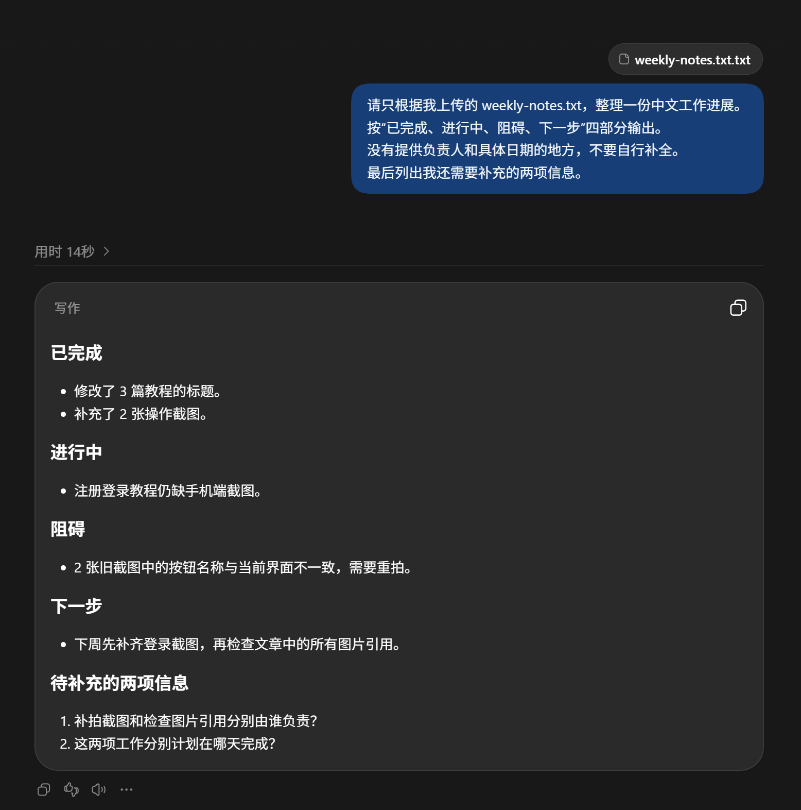

# ChatGPT Windows 桌面端安装与使用：下载、登录和第一次文件任务

[知识库首页](../README.md) · [网页、手机与桌面](../catalog/topics/devices.md) · [已上线教程](../README.md)

资料核对：2026-11-03。适用环境：Windows官方ChatGPT桌面应用；界面步骤待结合实机截图复核。

> **先看结论：** 经常在Windows上写文档、整理材料，可以安装ChatGPT桌面应用，把它作为日常工作入口。网页版仍然可以使用，是否安装主要取决于你是否需要桌面端的操作方式。

<details>
<summary>本篇导航</summary>

- [一、从官方入口下载](#section-01)
- [二、第一次打开，先核对账号与模式](#section-02)
- [三、做一个Windows文件整理练习](#section-03)
- [四、文件权限应该怎么给](#section-04)
- [五、常见问题](#section-05)

</details>

<a id="section-01"></a>

## 一、从官方入口下载

打开[ChatGPT官方下载页](https://chatgpt.com/download/)，选择Windows入口；也可以从[官方Windows说明](https://learn.chatgpt.com/docs/app/windows)进入其指向的Microsoft安装渠道。

先核对应用名称和发布信息，再按商店或安装器提示安装。系统兼容性以当前商店页面及安装器检测结果为准，不从陌生网站下载“免登录会员版”或名称相似的安装包。


*官方 Windows 下载入口示例，具体安装流程以当前页面为准。*

安装遇到问题，先记录商店或安装器的错误文字。如果是公司电脑，检查是否受单位安装策略限制；不要为了装一个聊天应用先关闭系统防护。

<a id="section-02"></a>

## 二、第一次打开，先核对账号与模式

安装完成后打开应用，按提示登录自己的ChatGPT账号。以前在网页使用什么登录方式，这里优先使用相同方式；进入后核对账号标识和工作区。

当前官方桌面应用将聊天与较复杂的任务入口放在同一应用中。简单问答先用Chat；需要围绕文件完成工作时，再使用界面中可用的Work等入口。具体布局参考[官方桌面应用概览](https://learn.chatgpt.com/docs/app)。

如果网页有会员、应用里却显示不同状态，先核对账号和工作区，再按[订阅未生效指南](chatgpt-payment-troubleshooting.md)排查，不要直接再买一份。

<a id="section-03"></a>

## 三、做一个Windows文件整理练习

在记事本新建文本文档，输入下列虚构内容，保存为UTF-8格式的 `weekly-notes.txt`：

```text
本周完成：修改了3篇教程的标题，补了2张操作截图。
进行中：注册登录教程还缺手机端截图。
问题：两张旧截图中的按钮名称与现在不同，需要重拍。
下周计划：先补登录截图，再检查文章内的全部图片引用。
```

在应用输入区使用实际提供的附件入口选择该文件；若支持拖拽，也可以拖入。确认附件名称出现后发送：

```text
请只根据我上传的 weekly-notes.txt，整理一份中文工作进展。
按“已完成、进行中、阻碍、下一步”四部分输出。
没有提供负责人和具体日期的地方，不要自行补全。
最后列出我还需要补充的两项信息。
```

检查结果是否保留“3篇”“2张”，是否把“还缺手机端截图”归入进行中，以及是否把待办误写成已完成。对话成功且能准确读取文件，才说明这个练习已完成。



*文件任务示例。截图中文件名显示为 weekly-notes.txt.txt，核对文件内容后按实际文件名操作。*

<a id="section-04"></a>

## 四、文件权限应该怎么给

对于这个小练习，选择单个文件就够了。如果使用需要读取本地文件夹的工作方式，先建立只含练习材料的文件夹，并确认应用请求的范围。不要把整个个人文档目录当作初次练习材料。

处理结束后，把最终正文另存到自己的文档里。需要生成文件时，应检查实际交付的文件是否能打开、内容是否完整，而不是只看回复说“已完成”。

<a id="section-05"></a>

## 五、常见问题

**安装好了却无法登录：** 返回[登录排查](chatgpt-sign-up-login.md)，区分认证问题与安装问题。

**文件没有被读到：** 先看附件是否上传完成、文件是否能在本地正常打开，再检查格式与提示。先用本例短文本排除文件本身过大或内容复杂的问题。

**不知道该选哪个复杂设置：** 第一次保留默认设置，用短任务验证流程。遇到具体限制时再调整，避免一次改多项后难以判断原因。

熟悉基本操作后，可以继续做PDF阅读或表格分析练习。

## 接下来按你的情况继续

- 处理本地文件：在指定练习目录生成一个可复查的输出文件。
- [iPhone与Android](chatgpt-mobile-app.md)：正确安装登录并完成可检查的短任务。

[返回网页、手机与桌面专题](../catalog/topics/devices.md) · [完整目录](../catalog/ALL_ARTICLES.md)
