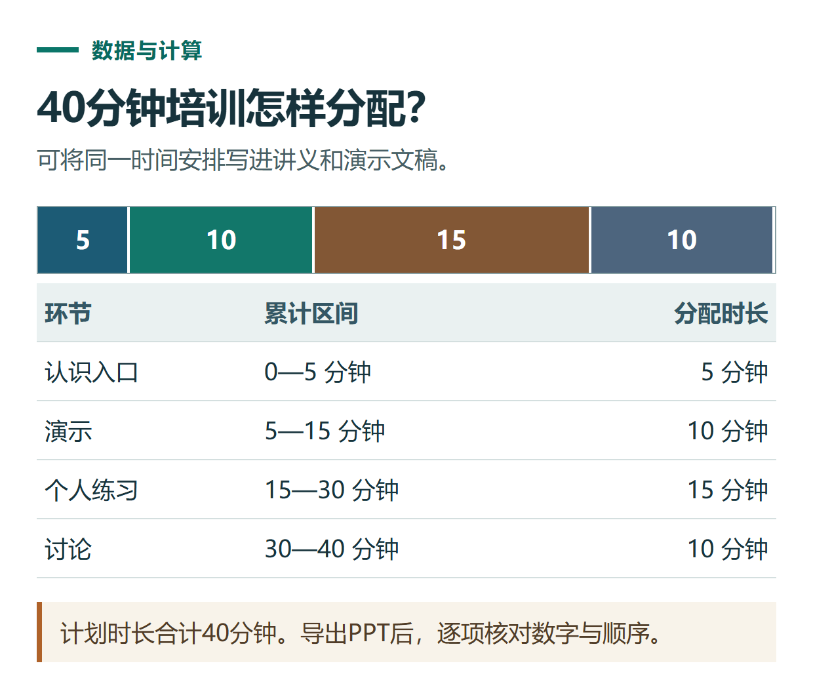

# ChatGPT 怎么生成 Word 和 PPT 文件？从材料、版式到下载验收

[知识库首页](../README.md) · [文件、表格与图表](../catalog/topics/data-files.md) · [按问题找答案](../catalog/TASKS.md)

资料核对：2026-11-03。适用环境：支持文件制作的ChatGPT Work；以下为原创演示需求，尚未运行生成文件。

> **先看结论：** 想获得Word文档或PPT，必须在任务里说明要交付实际文件。只说“写一个PPT”，可能得到的是逐页提纲；提纲有用，但与可以打开、修改和演示的文件是两种成果。

官方[文件制作与预览说明](https://learn.chatgpt.com/docs/artifacts-viewer)介绍，Work可以围绕材料创建和修改文档、演示文稿等成果，并按使用端提供预览或下载。具体交付格式与工具能力应在当前环境确认。

本篇交付目标是能打开和编辑的Word与PPT；逐页讲什么、怎样演练，另看[演讲备注](chatgpt-presentation-speaking-notes.md)。

<details>
<summary>本篇导航</summary>

- [一、先准备一份完整材料](#section-01)
- [二、生成可编辑的Word讲义](#section-02)
- [三、把材料改成5页演示文稿](#section-03)
- [四、怎么提出有效的修改要求](#section-04)
- [五、下载以后做最后一轮验收](#section-05)

</details>

<a id="section-01"></a>

## 一、先准备一份完整材料

下面用同一套虚构材料做两种成果，方便对照：

```text
主题：新同事的AI工具入门分享
听众：8位没有使用经验的同事
总时长：40分钟
安排：认识入口5分钟，演示10分钟，个人练习15分钟，讨论10分钟
练习内容：把一段虚构工作记录整理成周报
检查重点：数字、时间、计划与完成状态
活动日期与主讲人：待确认
资料用途：内部试讲，不对外宣传
```

时间合计应为40分钟。真实任务还应补上现有模板、品牌规范和最终使用位置；没有模板就先指定简洁清楚的版式。

<a id="section-02"></a>

## 二、生成可编辑的Word讲义

在可用的Work环境发送：

```text
请根据材料生成一份可编辑的DOCX讲义，文件名为ai-training-handout.docx。
对象是中文新手，正文不超过3页。
内容包括：学习目标、40分钟安排表、一个练习、检查清单。
日期和主讲人写待确认；不要虚构收益、参加反馈或培训资质。
使用清楚的标题层级和易阅读的表格。
完成后提供实际文件，并说明检查了哪些内容。
如果当前不能生成DOCX，明确说明，不只把文字加上.docx后缀。
```

先读内容，再看排版。文章分段正确，却在下载文件里出现表格跨页、标题孤立或乱码，也不算完成。

<a id="section-03"></a>

## 三、把材料改成5页演示文稿

不要把讲义全文塞进幻灯片。继续提出明确的页面要求：

```text
用同一套事实材料制作5页PPTX，适合中文现场讲解。
第1页：主题和听众；第2页：本次学习目标；
第3页：40分钟安排；第4页：周报练习；第5页：核查清单。
每页突出一个重点，避免大段正文，演讲补充写进备注。
保持文字可编辑，不把整页做成一张图片。
提供实际PPTX文件，文件名为ai-training-slides.pptx。
```

如果得到的是协作文稿或在线Slides，先确认是否支持你需要的导出格式。在线页面、PPTX和PDF用途不同：能预览并不必然意味着所有元素可在PowerPoint中编辑。



*本篇练习图。计划时长合计40分钟。导出PPT后，逐项核对数字与顺序。*

<a id="section-04"></a>

## 四、怎么提出有效的修改要求

假设第3页时间表拥挤，可以发送：

```text
只调整第3页布局，保留5、10、15、10分钟和合计40分钟。
将四个环节改为更清楚的横向时间安排。
其他页面的文字、顺序与配色保持不变。
修改后检查文本是否超出边界，并提供新文件名。
```

指明页码和要保留的内容，比“再专业一点”更容易执行。新版本下载后再次检查，确认没有把已核对的数字改掉。

<a id="section-05"></a>

## 五、下载以后做最后一轮验收

检查文件能打开、页数符合要求、字体和图片显示正常、时间合计正确、待确认项没有被擅自补齐。需要打印的文档查看分页；需要投屏的PPT查看小字和颜色对比。

给最终文件加日期或版本号，把原始材料和审定版放在一起。链接失效时参考[下载问题排查](chatgpt-feature-file-troubleshooting.md)；需要多人一起改长文时，使用[Pages文稿编辑](chatgpt-pages-editing.md)的方式。

## 接下来按你的情况继续

- [Pages文稿编辑](chatgpt-pages-editing.md)：创建可编辑页面，完成选段修改、评论和共享范围检查。
- [PPT演讲备注](chatgpt-presentation-speaking-notes.md)：把材料做成5分钟演讲结构并准备逐页备注。

[返回文件、表格与图表专题](../catalog/topics/data-files.md) · [完整文章索引](../catalog/ALL_ARTICLES.md)
