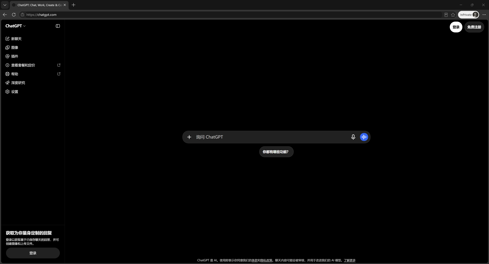
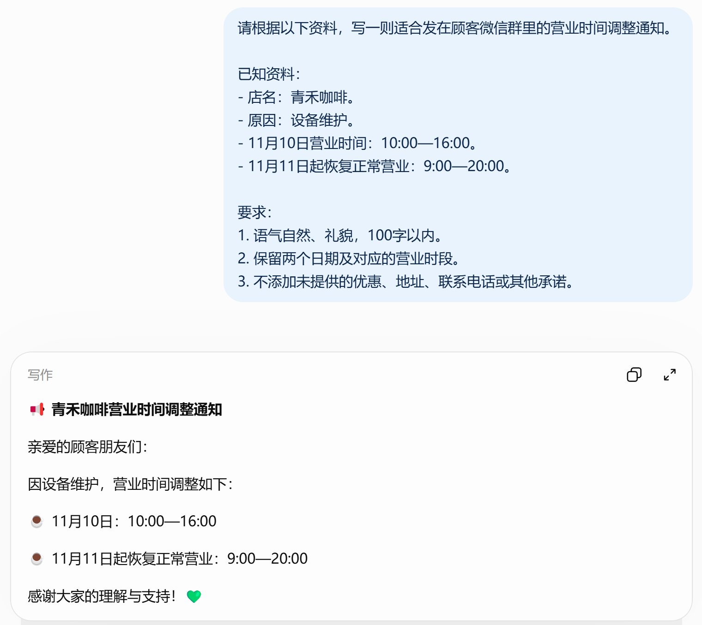
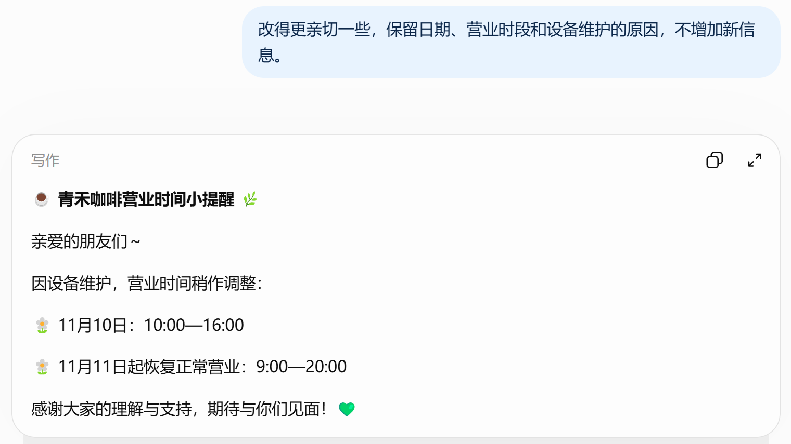

# ChatGPT 是什么？功能、用途与新手入门

[知识库首页](../README.md) · [认识与开始](../ROADMAP.md#module-01) · [已上线教程](../README.md)

作者：小小AI科技｜资料核对：2026年11月2日

> **先看结论：** **ChatGPT 是 OpenAI 提供的 AI 助手。你可以用中文向它提问、交代任务，让它解释知识、整理资料、起草内容，再通过追问逐步修改结果。** 官方使用指南也将这种“提出需求、补充材料、检查和修改”的过程作为基本使用方式。[官方使用说明](https://learn.chatgpt.com/docs/use-chatgpt)

第一次接触时，可以从自己熟悉的一件小事开始：修改一段通知、整理几条工作记录，或者弄懂一个概念。任务越具体，你越容易判断它是否帮上了忙。



*图1　打开网页版后，可以在中央的「询问 ChatGPT」输入框写下第一个问题。图中右上角显示「登录」和「免费注册」。*

<details>
<summary>本篇导航</summary>

- [一、OpenAI、GPT 和 ChatGPT 有什么区别？](#section-01)
- [二、ChatGPT 能做什么？先看这六类任务](#section-02)
- [三、ChatGPT 和搜索引擎有什么不同？](#section-03)
- [四、新手怎么用？先完成一个小练习](#section-04)
- [五、使用 ChatGPT 时，哪些内容要自己检查？](#section-05)
- [六、ChatGPT 要收费吗？新手怎么考虑订阅？](#section-06)
- [七、接下来从哪里学？](#section-07)

</details>

<a id="section-01"></a>

## 一、OpenAI、GPT 和 ChatGPT 有什么区别？

这三个名字经常一起出现，可以先这样区分：

| 名称 | 指什么 | 新手怎么理解 |
|---|---|---|
| OpenAI | 提供ChatGPT及相关AI模型的机构 | 看清产品与模型由谁提供 |
| GPT | OpenAI的一类AI模型，名称来自Generative Pre-trained Transformer | 负责处理输入、生成内容的底层技术 |
| ChatGPT | 面向用户的AI产品 | 你实际打开、输入问题和使用工具的地方 |

OpenAI的基础概念文档将GPT介绍为可处理语言、生成内容和代码的模型。ChatGPT则把对话界面、模型和可用工具组织成用户能操作的产品。[模型基础概念](https://developers.openai.com/api/docs/concepts)、[ChatGPT功能介绍](https://learn.chatgpt.com/docs/features)

日常说“用GPT写文章”，通常是在说使用ChatGPT或其他接入相关模型的工具。阅读教程时，最好先确认具体产品，再看模型与套餐，避免拿着一个网站的步骤去找另一个产品的按钮。

<a id="section-02"></a>

## 二、ChatGPT 能做什么？先看这六类任务

下面的任务可以作为尝试方向。具体功能是否可用，会受到套餐、平台、地区、开放进度和工作区设置影响。[官方适用条件说明](https://learn.chatgpt.com/docs/use-chatgpt)

| 场景 | 可以交给它的具体任务 | 你需要提供什么 |
|---|---|---|
| 学习与答疑 | 用生活例子解释复利，再出几道练习题 | 当前基础、想学的内容 |
| 写作与表达 | 修改公众号开头，把通知改得更清楚 | 原文、读者、语气与长度要求 |
| 日常办公 | 将会议记录整理为决定、负责人和待办 | 原始记录、需要的表格字段 |
| 资料与数据 | 提取PDF要点，对比材料，整理表格与图表 | 文件、分析目标、计算口径 |
| 图片创作 | 生成文章配图，按要求修改已有图片 | 用途、尺寸、风格、参考图 |
| 编程辅助 | 解释报错、梳理代码、起草修改方案 | 相关代码、报错、运行环境 |

表中的具体任务是本文设计的使用示例，不代表已完成实测。文件处理与图片创作的使用方式，可分别参阅[官方文件指南](https://learn.chatgpt.com/docs/artifacts-viewer)和[图片生成指南](https://learn.chatgpt.com/docs/image-generation)。

例如，要整理周报，可以先给出“本周完成事项、遇到的问题、下周安排”，再要求生成指定格式。这样，结果更容易与你的实际工作对应，你也能检查有没有遗漏或补写未经确认的信息。

### 界面中的 Chat 和 Work 是什么？

在提供这些入口的界面中，Chat适合提问、讨论和修改文字；Work适合围绕一个明确成果开展多步骤工作，例如结合文件完成分析、报告或演示文稿。新手可以先从普通对话开始，有成品文件需求时再了解Work。[官方网页端说明](https://learn.chatgpt.com/docs/web)

<a id="section-03"></a>

## 三、ChatGPT 和搜索引擎有什么不同？

可以根据任务这样选择：

- 想找到某项规则的原始公告，先找到发布方页面，核对日期和适用范围。
- 想把已经找到的几份资料整理成对比表，可以交给ChatGPT，并要求保留来源。
- 想查询最新信息，可以明确要求ChatGPT搜索，并检查它实际提供的引用。

ChatGPT本身也有网页搜索能力。是否使用了搜索，应看实际搜索记录和来源，不能仅凭回答语气判断。官方文档说明，使用网页搜索时，网页端会在对话中显示搜索结果和引用。[官方搜索说明](https://learn.chatgpt.com/docs/web-search)

例如，查询某项会员权益时，可以这样问：

> 请查找当前官方说明，回答这项功能的适用条件。列出来源链接，并区分官方已经确认的信息和目前无法确认的内容。

得到答案后，打开来源看一遍：说的是不是同一个产品、同一套餐和当前版本？这一步能帮助你发现引用错位或信息过期。

<a id="section-04"></a>

## 四、新手怎么用？先完成一个小练习

如果你已经能够在自己的ChatGPT账号中发送文字消息，可以直接复制下面的内容。尚未完成使用准备的读者，可以先了解任务怎么提出，再按后续教程操作。

**这是一个虚构咖啡店的练习，不是实际营业通知。**

```text
请根据以下资料，写一则适合发在顾客微信群里的营业时间调整通知。

已知资料：
- 店名：青禾咖啡。
- 原因：设备维护。
- 11月10日营业时间：10:00—16:00。
- 11月11日起恢复正常营业：9:00—20:00。

要求：
1. 语气自然、礼貌，100字以内。
2. 保留两个日期及对应的营业时段。
3. 不添加未提供的优惠、地址、联系电话或其他承诺。
```



*图2　首轮通知保留了设备维护的原因。11月10日调整为 10:00—16:00，11月11日起恢复为 9:00—20:00。*

把你得到的通知和原始资料对照，检查下面三件事。

1. 两个日期与营业时段是否对应正确。
2. 有没有擅自添加优惠、地址或联系电话。
3. 是否适合直接发给顾客，长度是否符合要求。

如果觉得太正式，可以继续说：

> 改得更亲切一些，保留日期、营业时段和设备维护的原因，不增加新信息。



*图3　追问后，标题从「青禾咖啡营业时间调整通知」改成了「青禾咖啡营业时间小提醒」，结尾多了一句「期待与你们见面！」。两版的日期、营业时段和维护原因一致。*

这类任务通常需要讲清目标、材料和输出要求，再根据结果追问。官方提示指南也建议按任务需要提供这些信息，无需每次套用复杂公式。[官方提问指南](https://learn.chatgpt.com/docs/prompting)

<a id="section-05"></a>

## 五、使用 ChatGPT 时，哪些内容要自己检查？

**第一，事实和数字。** 检查人名、日期、金额、计算结果和引用，确认能在原始材料中找到依据。

**第二，遗漏和猜测。** 原文没有负责人、截止时间或结论时，结果应保留“待确认”，不要为了表格完整就接受补写的内容。

**第三，信息是否适用。** 产品价格、功能入口和使用条件会变化，要确认资料属于当前产品和版本。OpenAI也提醒，表达流畅的回答仍可能不完整或有误，需要在使用前检查。[官方结果检查建议](https://learn.chatgpt.com/docs/use-chatgpt)

另外，练习时可以先使用虚构或脱敏材料。涉及客户信息、账号资料或公司文件时，先确认自己是否有权提供，以及当前使用环境的数据要求。

<a id="section-06"></a>

## 六、ChatGPT 要收费吗？新手怎么考虑订阅？

ChatGPT有免费和付费方案。不同方案的功能、用量及适用范围，需要结合当前官方说明和账号界面查看。[官方方案说明](https://learn.chatgpt.com/docs/pricing)

建议先想清楚三个问题：

- 我主要用它完成什么任务？
- 目前可用的功能和额度，是否已经影响实际工作？
- 准备购买的方案，是否明确包含我需要的能力？

“充值”也要分清具体对象：ChatGPT会员订阅、API计费和第三方服务费用是不同事项。API另有价格与计费安排，不能仅凭“充值成功”就判断买到了哪种权益。[官方计费区别说明](https://learn.chatgpt.com/docs/pricing)

如果需要了解ChatGPT会员代充、套餐选择或续费，可以查看[小小AI ChatGPT会员充值服务](https://xiaoxiao.pro/)，了解服务说明与咨询入口。小小AI是本知识库维护者提供的独立第三方服务，与OpenAI无隶属关系；具体费用及办理条件以服务页面和实际确认结果为准。

<a id="section-07"></a>

## 七、接下来从哪里学？

尚未开始使用，先读[使用前准备](chatgpt-china-preparation.md)与[注册登录](chatgpt-sign-up-login.md)。已经能登录，可以按7个新手练习逐步完成从提问到交付。

已经能够使用，可以从上面的通知练习开始，再尝试把材料换成自己的工作记录。每次选一个小任务，保留有效的提问方式，并检查结果是否真正满足需求。

[返回知识库首页](../README.md) · [完整目录](../ROADMAP.md)

## 接下来按你的情况继续

- [国内怎么用 ChatGPT](chatgpt-china-preparation.md)。连接 VPN 或机场代理，排查官网与登录问题，完成第一次中文对话。
- 7个新手练习：依次完成7个小任务并形成可核对的交付物。

[返回认识与开始专题](../ROADMAP.md#module-01) · [完整目录](../ROADMAP.md)
